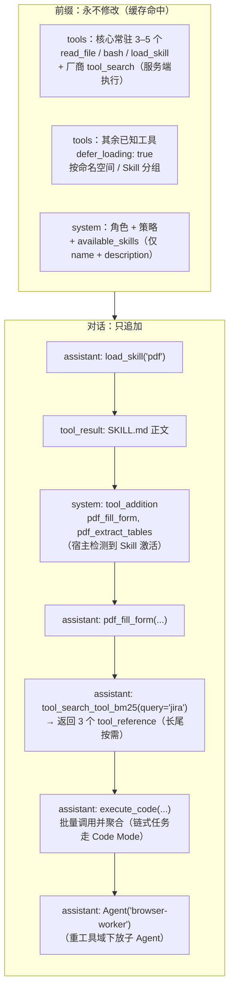

# LLM Agent 工具"渐进式暴露"（Progressive Tool Disclosure）深度调研报告

> 调研日期：2026-10-13（Asia/Shanghai）
> 范围：如何不在一开始就把所有工具注册给模型，而是按需（例如加载某个 Skill 之后）再暴露工具。
> 原则：所有引用均来自本次实际抓取的网页 / 实际 clone 并阅读的仓库文件 / 实际检索到的 X 帖子。仓库为 `git clone --depth 1` 的浅克隆，统一以 `仓库 @短 commit hash` 形式标注版本。

---

## 0. TL;DR（结论先行）

1. **你的两个假设都成立，而且都是业界主流做法。**
   - 假设 1（循环检测条件 → 下一次模型调用前注册新工具）：langgraph-bigtool、LangChain v1 middleware、OpenAI Agents SDK `is_enabled`、Goose `manage_extensions`、Claude Code（MCP `list_changed` 重新拉取）都是这么做的。**唯一的硬伤是 prompt cache**：工具定义位于 prompt 最前端，直接改 `tools` 数组会让整段缓存失效。
   - 假设 2（元工具调用"只在 prompt 里描述、未注册 schema"的工具）：Roo Code / Cline 的 `use_mcp_tool`、Goose 的 `execute_typescript` 回调、smolagents `CodeAgent`、Cloudflare / Codex 的 Code Mode、OpenHands 的 `invoke_skill` 都是这一类。代价是失去原生 function-calling 的 schema 约束与逐工具权限/可观测性。
2. **2025-11 之后，厂商把"假设 1"做成了缓存友好的原生能力**：Anthropic `defer_loading` + Tool Search（`tool_reference` 以内联方式追加，前缀不变）；OpenAI Responses API `tool_search`（新工具注入到上下文末尾）；Anthropic 2026-09 的 `inline-tools-2026-09-15` beta 进一步支持**在对话中途用 `role:"system"` 消息里的 `tool_addition` / `tool_removal` 增删工具甚至按值定义新工具，且不破坏缓存**。这是当前做"Skill 加载后才出现工具"最干净的官方方案。
3. **Manus 的经验仍然成立：不要在迭代中途随意增删 `tools` 数组**——要么"遮罩（mask）而非删除"，要么用"追加式（append-only）注入"。
4. **Code Mode / 程序化工具调用** 是另一条路线：把工具变成沙箱里的 API，模型写代码调用。Anthropic 报告 15 万 → 2 千 token（−98.7%），程序化调用平均 token −37%。适合多步链式、数据量大的任务。
5. **推荐混合架构**：稳定核心工具（3–5 个常驻）+ Skill 目录（只放 name/description）+ Skill 激活后通过"追加式注入"暴露其工具（托管 API：Anthropic `tool_addition`/`defer_loading`，OpenAI `tool_search`/`additional_tools`；都不支持时只追加不删除并接受一次缓存失效；Manus 式遮罩仅适用于能控制解码的自托管模型，见 §8）+ 长尾工具走 Tool Search + 重链式任务走 Code Mode + 工具域很重的任务下放到子 Agent。
6. **原生协议的"配对约束"真实存在但可控（§11）**：Anthropic、OpenAI、Gemini、DeepSeek、GLM 都强制 call/result 按 id 配对。Gemini 3 还要求回传 `thought_signature`，DeepSeek 在带 tools 时要求回传所有历史 `reasoning_content`，否则 400。解决办法是"历史规范化器 + 平衡点切分 + 摘要时把工具块转文本或整体丢弃"（Codex、OpenHands、LangChain、Cline、Roo、DeepSeek Harness）。大结果移出窗口的首选是**写入时卸载到文件、返回"预览 + 路径"**（DeepSeek Harness spill、Manus），不破坏配对也不伤缓存。占位符清理（Anthropic `clear_tool_uses`）和摘要是兜底手段，会让缓存失效。元工具并不能绕开配对，只有纯文本 ReAct/XML 能绕开，但会失去原生动态工具能力。DeepSeek 官方明确不支持服务端压缩，文档也未声明 `defer_loading`；GLM 的官方文档中未找到服务端压缩或动态工具能力。所以两家都建议 tools 恒定，配合 S4/S5。

---

## 1. 问题拆解：Registry（注册表） vs Exposure（暴露集）

几乎所有成熟实现都把两件事分开：

| 概念 | 含义 | 例子 |
|---|---|---|
| **Registry / Dispatch 表** | 宿主进程"知道怎么执行"的全部工具 | LangGraph `ToolNode(tool_registry.values())`；Codex `ToolExposure::Hidden`（"Keep this tool registered for dispatch without exposing it to the model"） |
| **Exposure / 模型可见集** | 本次请求里模型"看得到 schema"的工具 | `llm.bind_tools([retrieve_tools, *selected_tools])`；Anthropic 非 deferred 工具 |
| **Catalog / 目录** | 模型只看到名字+一句话描述，不看 schema | Skills 的 `<available_skills>`；Claude Code MCP Tool Search 启动时"Only tool names and server instructions load" |

"渐进式暴露"本质上就是：**Registry 全量、Exposure 按需、Catalog 低成本常驻**。不同方案的差别在于：
- Exposure 的变化**由谁触发**（宿主代码规则 / 模型调用元工具 / 检索器 / 服务端事件）；
- 变化**落在 prompt 的哪里**（改前缀的 `tools` 数组 → 缓存失效；追加到对话尾部 → 缓存保留；根本不进 `tools`，以文本/代码 API 形式存在 → 无 schema 约束）。

LangChain v1 把这个分离写进了报错信息里（`libs/langchain_v1/langchain/agents/factory.py` 中的 `DYNAMIC_TOOL_ERROR_TEMPLATE`）：中间件添加了 agent 不知道如何执行的工具时，给出两个选项——"Option 1: Register tools at agent creation"（预注册、只控制暴露），"Option 2: Handle dynamic tools in middleware … implement wrap_tool_call … handler(request.override(tool=my_dynamic_tool))"（暴露和执行都动态）。

---

## 2. 假设验证

### 2.1 假设 1：Agent 循环检测条件，在下一次模型调用前注册新工具 —— ✅ 成立

**典型实现 A：langgraph-bigtool**（`langchain-ai/langgraph-bigtool` @fede443，`langgraph_bigtool/graph.py`）

```python
# 状态里维护一个"已选工具 id"列表，reducer 为去重追加
selected_tool_ids: Annotated[list[str], _add_new]          # L22

def call_model(state, config, *, store):
    selected_tools = [tool_registry[id] for id in state["selected_tool_ids"]]   # L86
    llm_with_tools = llm.bind_tools([retrieve_tools, *selected_tools])          # L87
    response = llm_with_tools.invoke(state["messages"])
    return {"messages": [response]}

tool_node = ToolNode(tool for tool in tool_registry.values())   # 执行层是全量注册表

def select_tools(tool_calls, config, *, store):
    ...
    result = retrieve_tools.invoke(kwargs)                      # 用 store/embedding 检索
    ...
    return {"messages": tool_messages, "selected_tool_ids": tool_ids}           # L113
```

机制走读：
1. 初始只暴露 `retrieve_tools` 这个元工具；
2. 模型调用 `retrieve_tools(query)` → `select_tools` 节点检索出 tool_ids 写回 state；
3. 下一轮 `call_model` 重新 `bind_tools`，新工具出现在 schema 里；
4. 执行层 `ToolNode` 一开始就持有全部工具，所以不存在"能看见但不能执行"的问题。

这就是你的假设 1 的教科书实现，触发者是模型（通过元工具），注册动作由循环完成。**缺点**：每次 `bind_tools` 都会改变 `tools` 数组 → 对 Anthropic/OpenAI 来说整段前缀缓存失效（详见 §4）。

**典型实现 B：LangChain v1 中间件**（`langchain-ai/langchain` @8ace87e，`libs/langchain_v1/langchain/agents/middleware/tool_selection.py`）

`LLMToolSelectorMiddleware(model=..., max_tools=..., always_include=[...])` 在 `wrap_model_call` 中先用一个小模型从全量工具里挑选，再：

```python
return request.override(tools=[*selected_tools, *provider_tools])   # L353
```

这是"由宿主代码在每次模型调用前决定暴露集"的版本。`always_include` 用于钉住核心工具（不计入 `max_tools`）。

**典型实现 C：OpenAI Agents SDK `is_enabled`**（文档 https://openai.github.io/openai-agents-python/tools/）
函数工具的 `is_enabled` 可以是 bool 或 `(ctx, agent) -> bool` 的回调，"Disabled tools are completely hidden from the LLM at runtime"，并且在每次调用前重新求值。这就是"条件触发"最直接的 API：比如 `is_enabled=lambda ctx, agent: "pdf" in ctx.context.loaded_skills`。

**典型实现 D：Goose `manage_extensions`**（`block/goose` @89d732a，`crates/goose/src/agents/platform_extensions/ext_manager.rs`）

```text
- search_available_extensions: Find extensions available to enable/disable
- manage_extensions: Enable or disable extensions
...
When you lack the tools needed to complete a task, use search_available_extensions first
to discover what extensions can help.
```

模型自己调用 `manage_extensions(action=Enable, extension_name=...)`，Goose 在运行时连接该扩展（MCP server），下一轮其工具即可见。测试用例里还约束了：子 agent 不能管理扩展、扩展管理器不能禁用自己——这是防止模型把自己"锁死"的护栏。

**典型实现 E：Claude Code + MCP `list_changed`**
- MCP 规范（https://modelcontextprotocol.io/specification/2025-06-18/server/tools）：服务器声明 `{"tools":{"listChanged":true}}`，工具变化时发 `notifications/tools/list_changed`，客户端重新 `tools/list`。
- Claude Code 文档（https://code.claude.com/docs/en/mcp）：收到 `list_changed` 后重新拉取；`-p`/SDK 模式只刷新 tools，刷新失败保留旧列表；会话中途连上的 server，其工具名会在**同一轮的下一次请求**里列给模型。
- 这意味着 **MCP Server 自己也可以实现"渐进暴露"**：例如先只暴露 `login`/`select_project`，状态满足后再发 `list_changed` 暴露更多工具。

**典型实现 F：Roo Code 按模式（mode）分组**（`RooCodeInc/Roo-Code` @b867ec9，`src/shared/tools.ts`）
`TOOL_GROUPS`（read/edit/command/mcp/modes）按当前 mode 暴露不同工具组，`ALWAYS_AVAILABLE_TOOLS` 中包含 `switch_mode` 与 `skill`。模型调用 `switch_mode` → 下一轮工具集变化，是"状态机驱动的暴露集"。

**典型实现 G：AutoGen Workbench**（`microsoft/autogen` @027ecf0）
`python/packages/autogen-core/src/autogen_core/tools/_workbench.py` 中 `class Workbench` 的文档字符串写明："The tools provided by the workbench may be dynamic and their availabilities may change after each tool execution."——接口层面就把"工具集可在每次工具执行后变化"作为一等语义，agent 通过 `list_tools()` 获取当前可用工具、`call_tool()` 执行。`autogen-ext/.../tools/mcp/_workbench.py` 的 `McpWorkbench.list_tools()`（L274）每次调用都向 MCP server 发 `list_tools` 请求并应用 `tool_overrides`（改名/改描述），因此 server 端工具变化会在下一次 `list_tools()` 时反映出来。

**结论**：假设 1 正确，且是最直观的方案。真正需要设计的是"新工具落在 prompt 的什么位置"——这决定了缓存成本（§4）。

### 2.2 假设 2：元工具调用"只在 prompt 中描述、未注册 schema"的工具 —— ✅ 成立

**典型实现 A：Roo Code / Cline 的 `use_mcp_tool`**
- Roo（`src/shared/tools.ts` L117）：`use_mcp_tool: { server_name; tool_name; arguments? }`。
- Cline 旧枚举（`apps/vscode/src/shared/tools.ts`，`cline/cline` @ed469c7）：`MCP_USE = "use_mcp_tool"`、`MCP_ACCESS`、`MCP_DOCS = "load_mcp_documentation"`。
- MCP 工具的说明写在 system prompt 里，模型通过一个通用元工具"转发调用"。
- **值得注意的演进**：Roo 代码注释写明在 native 模式下 MCP 工具"现在直接以 `mcp_serverName_toolName` 调用，而不是通过 use_mcp_tool 包装"；`src/core/prompts/tools/native-tools/mcp_server.ts` 的 `getMcpServerTools` 把每个启用的 MCP 工具展平为原生定义（跳过 `enabledForPrompt === false`）。Cline 新 SDK `sdk/packages/core/src/extensions/mcp/tools.ts` 的 `createMcpTools` 也把每个 MCP descriptor 展平为 `AgentTool`。**这说明：当模型原生 function calling 足够强时，社区倾向于从"元工具转发"回到"原生 schema"，以换取参数准确性与约束解码。**

**典型实现 B：Goose Code Mode 回调**（`platform_extensions/code_execution.rs`）
暴露 `list_functions`、`get_function_details`、`execute_typescript`（Deno 运行时），默认 `CODE_MODE_TOOL_DISCLOSURE = "catalog"`。注入给模型的提示（L631）：

```text
{function_count} callback functions are available only from inside execute_typescript.
Do not call callback function names directly as tools. Use list_functions and
get_function_details to inspect signatures before writing one execute_typescript call.
```

这几乎是假设 2 的原文：工具"存在但未作为 schema 注册"，只能在代码里调用，且按需查看签名（渐进式）。

**典型实现 C：smolagents `CodeAgent`**（`huggingface/smolagents` @96f33fa）
- `prompts/code_agent.yaml` 把工具渲染为 Python 函数签名放进 system prompt（"these tools are basically Python functions which you can call with code"）；
- `agents.py` L492：`self.python_executor.send_tools({**self.tools, **self.managed_agents})` —— 工具只存在于 prompt 文本 + 执行器命名空间，没有 JSON schema 注册。

**典型实现 D：OpenHands `invoke_skill`**（`OpenHands/software-agent-sdk` @4011cb5，`openhands-sdk/openhands/sdk/tool/builtins/invoke_skill.py`）

```python
class InvokeSkillAction(Action):
    name: str = Field(description="Name of the loaded skill to invoke.")

TOOL_DESCRIPTION = """Invoke a skill by name.
This is the only supported way to invoke a skill listed in
`<available_skills>`. Call it with the `<name>` shown in that block; the
skill's full content is rendered (including any dynamic context) and
returned as the tool result.
"""
```

Skill 目录只在 prompt 中以 `<available_skills>` 列出，真正内容通过一个元工具以 tool_result 返回。

**典型实现 E：Anthropic Agent Skills**（https://www.anthropic.com/engineering/equipping-agents-for-the-real-world-with-agent-skills）
三级渐进披露：name+description 预加载 → 模型用 Bash 读 `SKILL.md` 正文 → 再按需读 `forms.md`/`reference.md` 等；Skill 附带的脚本可以**直接执行而无需进入上下文**。这里"工具"其实是 Skill 里的脚本/CLI，由通用的 Bash 工具调用——典型的假设 2。

**假设 2 的代价**：
- 内层调用没有 strict schema / constrained decoding，参数错误率更高；
- 权限、审批、审计粒度从"每个工具"退化为"元工具 + 参数"，需要自己在分发层补；
- 可观测性（trace 里只看到 `use_mcp_tool`）变差；
- 优点：`tools` 数组恒定 → **缓存极其友好**、工具数量几乎无限。

---

## 3. 策略全景（Taxonomy）

| # | 策略 | 触发者 | 新工具落点 | 代表实现 |
|---|---|---|---|---|
| S1 | 宿主循环动态 `bind_tools`（假设 1 朴素版） | 规则/状态/元工具 | 改 `tools` 前缀 | langgraph-bigtool、LangChain `wrap_model_call`、OpenAI `is_enabled`、Roo modes |
| S2 | **厂商原生延迟加载 + Tool Search** | 模型调用搜索工具 | 对话内联追加 | Anthropic `defer_loading` + `tool_search_tool_regex/bm25`；OpenAI `tool_search`；Codex `ToolExposure::Deferred`；Claude Code 默认 |
| S3 | **对话中途工具增删（追加式）** | 宿主代码 | `role:"system"` 消息中的 `tool_addition`/`tool_removal` | Anthropic `inline-tools-2026-09-15`；Anthropic Python SDK `runner.add_tools()` |
| S4 | 元工具转发（假设 2） | 模型 | 不进 `tools` | Roo/Cline `use_mcp_tool`、OpenHands `invoke_skill` |
| S5 | Code Mode / CodeAct / 程序化工具调用 | 模型写代码 | 沙箱 API | Cloudflare Code Mode、Anthropic "Code execution with MCP"、Anthropic PTC、Codex code-mode、Goose `execute_typescript`、smolagents |
| S6 | Skills 渐进披露 | 模型 | 文本/文件，工具即脚本 | Anthropic Skills、Claude Code skills、OpenHands、Codex skills、MCP SEP-2640 |
| S7 | 子 Agent 作用域工具 | 主 Agent 委派 | 子 Agent 独立上下文 | Claude Code subagents（`tools`/`mcpServers`）、OpenAI agents-as-tools |
| S8 | Handoff（转交） | 模型调用 `transfer_to_*` | 切换到另一个 Agent 的工具集 | OpenAI Agents SDK handoffs |
| S9 | 遮罩（Mask, don't remove） | 宿主状态机 | `tools` 不变，解码时限制 | Manus（logit masking / response prefill） |
| S10 | 客户端 RAG 选工具 / 检索微调 | 检索器 | 改 `tools` 或交给 S2 自定义搜索 | Gorilla、ToolLLM、LLMToolSelectorMiddleware |
| S11 | MCP `list_changed` | MCP 服务器 | 客户端重新拉取 | MCP 规范、Claude Code |
| S12 | 静态过滤 / 命名空间 | 配置 | 一次性收窄 | OpenAI `create_static_tool_filter`、`tool_namespace()`；Claude `disallowedTools` |

各策略的机制细节见 §5（§4 先讨论贯穿所有策略的 prompt cache 约束，它是比较各方案的前提）。

---

## 4. Prompt Cache：决定方案优劣的关键约束

### 4.1 为什么改 `tools` 代价巨大

Anthropic Prompt Caching 文档（https://docs.claude.com/en/docs/build-with-claude/prompt-caching）：
- "Prompt caching references the entire prompt: `tools`, `system`, and `messages` (in that order)"；
- 失效表："Tool definitions ✘ ✘ ✘ — Modifying tool definitions (names, descriptions, parameters) invalidates the entire cache"；
- 缓存读价格为基础输入价的 0.1×（部分新模型 0.05× 甚至 0.025×），5 分钟写入为 1.25×。

即：**哪怕只追加一个工具，只要改的是 `tools` 数组，整个会话历史都要按全价重算并重新写缓存（1.25×）。**

Manus（https://manus.im/blog/Context-Engineering-for-AI-Agents-Lessons-from-Building-Manus）把 KV-cache 命中率称为生产 Agent 最重要的单一指标：输入:输出约 100:1；Claude Sonnet 缓存输入 $0.30/MTok vs 未缓存 $3/MTok（10 倍差）。他们尝试过 RAG 式动态工具，结论是"unless absolutely necessary, avoid dynamically adding or removing tools mid-iteration"，两个原因：
1. 工具定义在前端，改动使后续全部 KV-cache 失效；
2. 历史中引用了已被删除的工具时，模型会困惑，产生 schema 违规或幻觉动作。

### 4.2 厂商如何让"动态工具"变得缓存友好

| 机制 | 做法 | 缓存影响 | 来源 |
|---|---|---|---|
| Anthropic `defer_loading` + Tool Search | 所有工具仍随请求发送，但 deferred 工具不渲染进前缀；搜索命中后在对话中追加 `tool_reference` | "The prefix is untouched, so prompt caching is preserved" | https://docs.claude.com/en/docs/agents-and-tools/tool-use/tool-search-tool |
| OpenAI `tool_search` | 发现的新工具"injected at the end of the context window" | 前缀保留；但**移除已加载工具会从该点起破坏缓存** | https://platform.openai.com/docs/guides/tools-tool-search |
| OpenAI `additional_tools` 输入项 | 在输入中指定位置（developer 角色）添加工具 | 追加式 | 同上 |
| Anthropic mid-conversation tool changes | `role:"system"` 消息内 `tool_addition`/`tool_removal`；`inline-tools-2026-09-15` 支持按值定义新工具、甚至 `mcp_toolset` | "The `tools` array itself never changes, so the cached prefix stays intact" | https://platform.claude.com/docs/en/build-with-claude/mid-conversation-system-messages |
| Manus 遮罩 | 工具集不变，用 prefill/logit mask 约束可选动作 | 完全不变 | Manus 博客 |
| Code Mode / 元工具 | `tools` 恒定 | 完全不变 | Cloudflare / Anthropic |

X 上的讨论也集中在这一点：
- https://x.com/kumarumt/status/2103917522009338198 ：OpenAI tool search 把加载的工具注入到末尾以保留缓存；
- https://x.com/anoymous_elangm/status/2108400073956892939 （中文）：Claude defer_loading 把 tool_reference 追加到历史、保留前缀缓存，要区分"修改前缀"和"发现 deferred 工具"；
- https://x.com/Yu2002964143523/status/2101311654189502813 ：长文《不破坏 KV Cache 缓存的 Agent 工具延迟加载机制》（Anthropic / OpenAI / Pi）；
- Pi 0.86 / 1.0 发布讨论："dynamic tools without losing KV cache"（https://x.com/hars_7086/status/2101584717447344410 ）、"deferred tool loading, cache warming"（https://x.com/realpython/status/2106044070401306876 、https://x.com/HermesAtGoke/status/2106002802493272071 ）。

### 4.3 粗略成本模型

符号：H = 已缓存的会话历史 token；T = 修改前的工具定义 token；T_new = 修改后的工具定义 token；ΔT = 追加的新工具定义 token；p = 基础输入单价；缓存读 0.1p、5 分钟缓存写 1.25p（Anthropic 标准倍率，部分新模型读价更低）：
- **朴素改 `tools`（S1）**：该次请求成本 ≈ 1.25p·(T_new + H)（工具在前缀最前端，其后全部重新写入缓存）。例：H = 80K、T_new = 5K、p = $3/MTok → 1.25 × 3 × 85K / 1M ≈ **$0.32**；若不切换、整段命中缓存则 ≈ 0.1 × 3 × (T + H)，取 T = 5K 时约 **$0.026**——**单次切换约贵 12 倍**。
- **追加式（S2/S3）**：≈ 0.1p·(T+H) + 1.25p·ΔT，ΔT 是新增工具定义的大小（通常几百到几千 token）。
- **Code Mode / 元工具（S4/S5）**：`tools` 恒定，新增信息只以 tool_result 形式进入。

结论：**如果工具切换频率 ≥ 每几轮一次、且会话很长，朴素 S1 在成本和延迟（TTFT）上都会明显吃亏。**

---

## 5. 逐项目 / 逐方案实现细节

### 5.1 Anthropic：Tool Search Tool + `defer_loading`

来源：https://www.anthropic.com/engineering/advanced-tool-use （2025-11-24）、https://docs.claude.com/en/docs/agents-and-tools/tool-use/tool-search-tool

请求形态（示意，字段名来自官方文档；含注释与 `{...}` 省略，故标注为 jsonc）：

```jsonc
{
  "tools": [
    {"type": "tool_search_tool_regex_20251119", "name": "tool_search_tool_regex"},
    {"name": "read_file", "description": "...", "input_schema": {...}},          // 常驻
    {"name": "github_create_pr", "description": "...", "input_schema": {...},
     "defer_loading": true},                                                     // 延迟
    {"type": "mcp_toolset", "mcp_server_name": "jira",
     "default_config": {"defer_loading": true},
     "configs": {"jira_search": {"defer_loading": false}}}
  ]
}
```

要点：
- 搜索器有 regex（pattern ≤200 字符）与 BM25（query ≤500 字符）两种；默认返回最多 5 个 `tool_reference`（可调 1–10,000）；最多 10,000 个 deferred 工具；
- **至少一个工具必须非 deferred**（否则报 "All tools cannot be deferred"）；deferred 工具不能带 `cache_control`（400）；
- 自定义搜索：你自己实现一个普通工具（如向量检索），在 `tool_result` 里返回 `tool_reference` 块即可——**这就是"Skill 加载后暴露工具"的官方钩子**：`load_skill("pdf")` 的 tool_result 里直接返回该 Skill 的 `tool_reference` 列表；
- Strict 模式语法基于完整工具集构建；
- 文档建议：选择准确率在 30–50 个工具后下降；少于 10 个工具时普通调用更好；
- 官方数据：5 个 server / 58 个工具约 55K token，见过 134K token 的工具定义；传统方式约 77K token vs Tool Search 约 8.7K token。**原文表述为"85% reduction in token usage"；但按原文自己给出的 8.7K / 77K 计算，降幅约为 88.7%**，原文未解释两者差异（可能是取整或口径不同），本报告引用时以原文"85%"为准并注明该出入；准确率 Opus 4：49% → 74%，Opus 4.5：79.5% → 88.1%；
- 建议：工具定义 >10K token、≥10 个工具或多 MCP server 时启用；把 3–5 个最常用工具设为常驻。

同文还介绍了 **Programmatic Tool Calling**（`allowed_callers: ["code_execution_20250825"]`）：平均 token 43,588 → 27,297（−37%），知识检索 25.6% → 28.5%，GIA 46.5% → 51.2%；以及 **Tool Use Examples**（`input_examples`）：复杂参数准确率 72% → 90%。

### 5.2 Anthropic：对话中途增删工具（`tool_addition` / `tool_removal`）—— 最贴合"Skill 加载后才出现工具"

来源：https://platform.claude.com/docs/en/build-with-claude/mid-conversation-system-messages ；SDK：https://cdn.jsdelivr.net/gh/anthropics/anthropic-sdk-python@b4b7916deaf4e5570cd627b1ae7ee4394a4de39f/tools.md

三种操作（按引用添加 / 按值添加 / 移除）：

```jsonc
// 1) 按引用：工具已在 tools[] 中声明为 defer_loading:true，此处"解锁"
{"role": "system", "content": [
  {"type": "tool_addition", "tool": {"type": "tool_reference", "name": "pdf_fill_form"}}
]}

// 2) 按值（inline-tools-2026-09-15）：首个请求时还不知道的工具，直接定义
{"role": "system", "content": [
  {"type": "tool_addition", "tool": {"type": "tool_definition", "definition": {
     "name": "db_query", "description": "Run a read-only SQL query...",
     "input_schema": {"type": "object", "properties": {"sql": {"type": "string"}}, "required": ["sql"]}
  }}}
]}

// 3) 移除
{"role": "system", "content": [
  {"type": "tool_removal", "tool": {"type": "tool_reference", "name": "get_weather"}}
]}
```

关键规则（原文要点）：
- "`tools` 数组本身不变，所以缓存前缀保持完整"；按值定义"only the appended message is processed as new input"；
- **"Declare what you know up front"**：已知工具放 `tools` 并 `defer_loading:true`，之后用引用解锁；只有首个请求时未知或之后会变的才按值定义；
- 保持至少一个非 deferred 工具，否则首个按值定义的工具会导致一次完整缓存未命中；
- 同名重新定义可以改 schema；不同类型同名报 `tool_name_conflict`；
- 位置约束：必须紧跟 `user` 回合（包括携带 `tool_result` 的 user），并位于 `assistant` 之前或作为最后一条；不能插在 `tool_use` 与其 `tool_result` 之间；
- 还可以按值加入 `mcp_toolset`（需 `mcp-client-2026-09-15`）；
- 限制：deferred 工具 ≤10,000、渲染后的工具文本 ≤4MB 等（`available_tools_limit_exceeded`）；
- 安全：system 消息具有运营者权限，**不要把工具输出/网页内容放进 system 消息**。

Python SDK 封装：

```python
runner = client.beta.messages.tool_runner(
    model=MODEL_ID,   # SDK 文档示例原文为 "claude-sonnet-5-5"；请以你账号可用的模型 ID 为准
    max_tokens=1024,
    betas=["inline-tools-2026-09-15"],
    tools=[get_time], messages=[...])
for message in runner:
    if calendar.just_connected():
        runner.add_tools(find_free_slots)
    if calendar.just_disconnected():
        runner.remove_tools(find_free_slots)
```

SDK 文档提醒：用 `set_messages_params()` 直接改 `tools` 会 miss 缓存，且执行层不同步（新增的会被回答 "not found"）；compaction 后如果响应里没有 `tool_changes`，需要重新 `add_tools()`。

> 这就是你说的假设 1 的"官方缓存友好版"：**循环检测条件（Skill 被加载）→ 在下一次请求前追加一条 system 消息 `tool_addition`**，而不是改 `tools`。

### 5.3 OpenAI：Responses API `tool_search` 与 Agents SDK

来源：https://platform.openai.com/docs/guides/tools-tool-search 、https://openai.github.io/openai-agents-python/tools/

- `{"type":"tool_search"}` + 函数/命名空间/MCP 上的 `defer_loading`；文档原文："In the Responses API, only `gpt-5.4` and later models support `tool_search`."；
- 发现的新工具"injected at the end of the context window"以保留缓存；移除已加载工具会从该点起破坏缓存；
- 推荐用 **namespace** 或 MCP server 组织，单个 namespace 控制在 10 个函数以内；**被 defer 的独立函数的名字和描述依然可见，所以实际上主要延迟的是参数 schema**；
- 两种执行模式：hosted；client-executed（`tool_search_call` / `tool_search_output`，`execution:"client"`）——后者允许你自己写检索逻辑（例如"Skill 激活 → 返回该 Skill 的工具"）；
- `additional_tools` 输入项（developer 角色）可在输入的指定位置追加工具；
- Agents SDK：`ToolSearchTool()`、`@tool(defer_loading=True)`、`tool_namespace()`、`HostedMCPTool(defer_loading=...)`；client 模式不会被 Runner 自动执行；`ProgrammaticToolCallingTool`（`allowed_callers=["programmatic"]`）；`is_enabled` 动态隐藏。

`openai/openai-agents-python` @f53c624 中：
- `src/agents/handoffs/__init__.py` L216：handoff 默认工具名 `transfer_to_{agent.name}`；
- `src/agents/mcp/util.py`：`create_static_tool_filter(allowed_tool_names, blocked_tool_names)`；
- `src/agents/mcp/server.py`：`cache_tools_list` 与 `invalidate_tools_cache()`——在 MCP 工具变化时手动失效本地工具列表缓存。

### 5.4 OpenAI Codex CLI：`ToolExposure` 的 6 个枚举值

`openai/codex` @6fbfc35

`codex-rs/tools/src/tool_executor.rs`：

```rust
pub enum ToolExposure {
    /// Include this tool in the initial model-visible tool list.
    /// When code mode is enabled, this tool is also available as a nested code-mode tool.
    Direct,
    /// Register this tool for later discovery, but omit it from the initial
    /// model-visible tool list. Deferred tools must provide search metadata ...
    Deferred,
    /// Make this tool discoverable through tool search without allowing nested Code Mode calls.
    DeferredModelOnly,
    /// Include this tool in the initial model-visible tool list only.
    DirectModelOnly,
    /// Expose this tool only to nested Code Mode calls ...
    CodeModeOnly,
    /// Keep this tool registered for dispatch without exposing it to the model.
    Hidden,
}
```

这是目前看到的**最清晰的 Registry/Exposure 分离设计**：注册（可分发执行）与暴露正交。6 个枚举值可以理解为在 3 个"暴露面"上的不同组合（依据源码注释整理）：

| 枚举值 | 初始工具列表可见 | 可被 tool search 发现 | 可在 Code Mode 内嵌调用 |
|---|---|---|---|
| `Direct` | ✅ | —（已可见） | ✅ |
| `Deferred` | ❌ | ✅ | ✅（注释未明说；由 `DeferredModelOnly`"without allowing nested Code Mode calls"反推） |
| `DeferredModelOnly` | ❌ | ✅ | ❌ |
| `DirectModelOnly` | ✅ | —（已可见） | ❌ |
| `CodeModeOnly` | ❌ | ❌ | ✅ |
| `Hidden` | ❌ | ❌ | ❌（仅保留分发） |

- `codex-rs/core/src/tools/handlers/tool_search.rs`：`ToolSearchHandler` 对 deferred 工具的 `search_text` 建 BM25 索引；`ToolSearchHandlerCache` 只有在工具来源变化时才重建；从 Code Mode 内部嵌套调用时返回名字+描述的 JSON 列表；
- `codex-rs/core/templates/search_tool/tool_description.md`："Searches over apps/connectors tool metadata with BM25 and exposes matching tools for the next model call… Some of the tools may not have been provided to you upfront…"——注意 **"exposes matching tools for the next model call"**，正是假设 1 的语义；
- `codex-rs/core/src/tools/code_mode/execute_spec.rs`：`create_code_mode_tool` 生成一个 Freeform 工具，用 Lark 语法（`// @exec:` pragma）约束输出——**给 Code Mode 加了语法级约束解码，部分弥补了假设 2 "无 schema 约束"的弱点**；
- Skills：`codex-rs/skills`、`core/src/skills.rs`、`core/src/mcp_skill_dependencies.rs`（Skill 可声明依赖的 MCP 服务器）。

### 5.5 Claude Code：Skills + Tool Search + Subagents 三件套

**Skills**（https://code.claude.com/docs/en/skills）
- frontmatter：`allowed-tools`（激活期间对这些工具免审批，**但"does not restrict which tools are available"**）、`disallowed-tools`（激活期间从工具池中移除，下一条消息时清除）、`context: fork` + `agent`（在子 agent 里跑 Skill）、`paths`（按文件路径触发）、`disable-model-invocation`、`hooks`、`model`；
- description + `when_to_use` 合计上限 1,536 字符；Skill 列表预算为上下文窗口的 1%；
- Skill 内容被调用后在会话中持续存在；compaction 后重新附加（每个 Skill 前 5,000 token，合计 25,000 token）；
- `!` 命令可做动态上下文注入。

> 注意：Claude Code 的 Skill **不会**因为激活而"注册新工具 schema"；它是"Skill 文本 + 通用工具（Bash/Read）+ 权限调整"的组合，即假设 2 路线；真正"新增工具"靠 MCP + Tool Search。

**MCP Tool Search**（https://code.claude.com/docs/en/mcp）
- 默认开启："Only tool names and server instructions load at session start"；`ENABLE_TOOL_SEARCH=false`、自定义 `ANTHROPIC_BASE_URL` 或老模型时关闭；
- `_meta["anthropic/alwaysLoad"]` 让 MCP server 把某个工具钉为常驻（X：https://x.com/nicklaunchesai/status/2108222429747405079 ）；
- 描述截断 2,048 字符（`CLAUDE_CODE_MAX_MCP_DESCRIPTION_LENGTH`）；`list_changed` 动态刷新；会话中途连接的 server 在同轮下一次请求列出工具名。

**Subagents**（https://code.claude.com/docs/en/sub-agents）
- `tools` / `disallowedTools`（支持 `mcp__server` 模式）、`mcpServers`（"To keep an MCP server out of the main conversation entirely… define it inline here"，inline server 只为该子 agent 连接）、`skills` 预加载、`Agent(worker, researcher)` 白名单；
- **fork 型子 agent 与父共享 prompt cache**（system prompt 与工具完全一致）；非 fork 子 agent 有独立缓存；
- 合计描述超过 15K token 会给出启动警告。

### 5.6 Goose（Block）

`block/goose` @89d732a
- `ext_manager.rs`：`search_available_extensions` / `manage_extensions` / `list_resources` / `read_resource`（见 §2.1-D）。这是"模型驱动的假设 1"：扩展=MCP server，按需连接；
- `code_execution.rs`：`list_functions` / `get_function_details` / `execute_typescript`（Deno），`CODE_MODE_TOOL_DISCLOSURE` 默认 `catalog`（只告诉模型"有 N 个回调函数"，函数名都不列，需要时再查）——**目录→签名→执行**的三级渐进披露，与 Skills 的三级结构同构。

### 5.7 Roo Code / Cline

- Roo `src/shared/tools.ts`：`TOOL_GROUPS` + mode 切换（S1 状态机版）；`use_mcp_tool`（S4）；`ALWAYS_AVAILABLE_TOOLS` 包含 `switch_mode`、`skill`；
- Roo `native-tools/skill.ts`："Load and execute a skill by name"；
- Roo `native-tools/mcp_server.ts`：`getMcpServerTools` 全量展平 + `enabledForPrompt` 过滤（用户在 UI 上逐工具关闭）；
- Cline 旧版 `use_mcp_tool` / `load_mcp_documentation` / `PLAN_MODE`/`ACT_MODE`；新 SDK `createMcpTools`（展平，`resultPolicy: "cache-oversized"`）+ `manager.ts` `refreshTools`（S11）。

演进趋势：**元工具转发 → 原生展平 + 用户/模式级过滤**。原因推测（未见官方说明，属推断）：原生 function calling 的参数准确率、并行调用与约束解码更好；工具数可控时没必要承担假设 2 的代价。

### 5.8 OpenHands Software Agent SDK

`OpenHands/software-agent-sdk` @4011cb5
- `tool/builtins/invoke_skill.py`：见 §2.2-D，记录 `invoked_skills`；
- `skills/trigger.py`：`KeywordTrigger`（关键词）、`TaskTrigger`、`PathTrigger`（glob 路径）——**宿主循环检测条件后注入 Skill 知识**（假设 1 的"知识"版本）；
- `skills/skill.py`：`mcp_tools: dict[str, MCPServer]`（"MCP servers for the skill (repo skills only)"）——Skill 可以携带 MCP server，即"加载 Skill → 带出工具"；`profiles/agent_profile.py` 中注明嵌入式 `skills[].mcp_tools` 在 #4017 中被移除（设计仍在演化）。

### 5.9 smolagents（Hugging Face）

见 §2.2-C。`CodeAgent`（agents.py L1505）+ `send_tools` 注入执行器；工具以 Python 签名出现在 system prompt。同时支持 managed agents（子 agent 也作为可调用对象注入）。

### 5.10 Cloudflare Code Mode

来源：https://blog.cloudflare.com/code-mode/ （2025-09-26）；仓库 `cloudflare/agents` @b1e3614
- 把 MCP 工具转成 TypeScript API，模型只拿到一个"执行代码"工具；V8 isolate + Worker Loader API；binding 隐藏 API key，`fetch()`/`connect()` 被阻断；
- 博客时点"目前会加载整个 API，搜索/浏览是未来工作"；
- 仓库 `packages/codemode/src/proxy-tool.ts` 头注释："One AI SDK tool with `{ code: string }`… Inside the sandbox: Connector SDKs as globals `<connector>.<method>(...)`; Platform SDK: `codemode.search/describe/step/run`"——**沙箱内已有 search/describe，即在代码层面实现了渐进发现**；并支持审批的 durable abort-and-replay。

### 5.11 Anthropic "Code execution with MCP"

来源：https://www.anthropic.com/engineering/code-execution-with-mcp （2025-11-04）
- 把工具组织成文件树 `servers/<server>/<tool>.ts`，agent 通过浏览文件系统发现工具 → **文件系统即目录**；
- 15 万 → 2 千 token（−98.7%）；
- 也可提供 `search_tools(query, detail_level)`：只要名字 / 名字+描述 / 完整 schema；
- 额外收益：中间数据不进上下文、PII token 化、状态持久化、把代码保存为 Skill；代价：需要安全沙箱与资源限制。

### 5.12 MCP 生态：`list_changed` 与 Skills over MCP（SEP-2640）

- `list_changed`：见 §2.1-E；
- `modelcontextprotocol/modelcontextprotocol` @3778656，`seps/2640-skills-extension.md`：Status **Final**，扩展标识 `io.modelcontextprotocol/skills`。每个 Skill 文件作为 MCP resource（`skill://` URI），新增 `skills/list`、`skills/get`、可选 `resources/directory/read`；Skill 格式与渐进披露模型完全委托给 Agent Skills 规范（agentskills.io）。动机之一是"server instructions 大小受限，复杂工作流（如 875 行的 mcpGraph skill）放不下"；
- `docs/extensions/skills/overview.mdx`："Reading `SKILL.md` through `resources/read` does not itself activate a skill. To load the skill, the host routes the read through its skill-loading path…"——**Skill 激活是宿主行为**，这正是挂"激活后暴露工具"钩子的地方；
- X：https://x.com/laytoun/status/2099917776404058200 、https://x.com/AndriiOnAI/status/2104311610588209602 。

### 5.13 LangChain v1：`ProviderToolSearchMiddleware`

`libs/langchain_v1/langchain/agents/middleware/provider_tool_search.py`：把指定工具标记为 `extras["defer_loading"]=True`，并按提供商注入：

```python
"anthropic": {"type": "tool_search_tool_bm25_20251119", "name": "tool_search_tool_bm25"},
"openai":    {"type": "tool_search"},
```

即把 S1（中间件）和 S2（厂商原生延迟）组合起来，**让框架层的"动态工具"走缓存友好路径**。

### 5.14 Manus：遮罩而非删除

来源：Manus 博客（2025-07-18，Yichao 'Peak' Ji）
- 用上下文感知的状态机管理工具可用性，通过 response prefill 实现 logit 约束；基于 Hermes 格式的三种模式：auto（可调用可不调用）、required（必须调用，任意工具）、specified（必须从指定子集调用，通过预填函数名前缀实现）；
- 工具命名用统一前缀（`browser_*`、`shell_*`），这样只需预填前缀就能把选择限制在一组工具内；
- 其它经验：文件系统作为外部上下文、`todo.md` 复述目标、错误保留在上下文中、避免 few-shot 模式固化。

局限：需要能控制解码（自托管模型或支持 prefill/约束的 API）；工具定义仍然全量占用上下文 token（只省缓存不省 token），所以**适合几十个工具的量级，不适合几百上千个**。

### 5.15 研究线：Gorilla、ToolLLM、CodeAct

- **Gorilla**（arXiv 2305.15334）：检索感知微调；非 oracle 检索器可能伤害效果（BM25/GPT-Index 在 TorchHub 下降 21.50%、HF 下降 47.57%）；零样本超过 GPT-4 20.43%。→ **检索质量是工具 RAG 的命门**。
- **ToolLLM**（arXiv 2307.16789）：16,464 个 API；神经检索器 NDCG@5 84.9 vs BM25 17.0 vs Ada 45.4；用检索 top-5 甚至优于 oracle API 集；DFSDT 搜索策略。→ 训练过的检索器能远超 BM25。
- **CodeAct**（arXiv 2402.01030）：以可执行代码为动作空间，成功率最高 +20%，动作数最多 −30%（gpt-4-1106 在 M3ToolEval 上 +20.7%）。

---

## 6. 多维对比

评分说明：所有星级列统一为 1–5 ★，**★ 越多越好**。"Token 节省"指相对全量预注册节省的上下文 token（★ 多 = 更省）；"延迟表现"★ 多 = 更快；"实现简易度"★ 多 = 更容易实现。"规模档位"为文字档：小（≲30 个工具）/ 中（数十到约百个）/ 大（数百）/ 很大（千级以上）。均为基于上述来源的定性综合，非统一基准实测；需要说明的情形放在表下脚注。

| 策略 | Token 节省 | 缓存友好 | 准确率（选择+参数） | 延迟表现 | 实现简易度 | 规模档位 | 主要风险 |
|---|---|---|---|---|---|---|---|
| 全量预注册（基线） | ★ | ★★★★★ | ★★★ ¹ | ★★★★ | ★★★★★ | 小 | 上下文膨胀、选错工具 |
| S1 朴素动态 `bind_tools` | ★★★★ | ★ | ★★★★ | ★★ ² | ★★★★ | 大 | 缓存失效；历史引用已删工具 |
| S2 厂商 Tool Search + defer | ★★★★ | ★★★★★ | ★★★★ ³ | ★★★ | ★★★★ | 很大 ⁴ | 搜索为空/搜错；厂商锁定 |
| S3 中途 `tool_addition`/`removal` | ★★★★ | ★★★★★ | ★★★★★ | ★★★★ | ★★★★ | 很大 ⁴ | beta；位置规则；仅特定模型 |
| S4 元工具转发 | ★★★★ | ★★★★★ | ★★ | ★★★ | ★★★ | 很大 | 无 schema 约束、参数错误；权限/审计粒度粗 |
| S5 Code Mode / PTC | ★★★★★ ⁵ | ★★★★★ | ★★★★ | ★★★ ⁶ | ★★ | 很大 | 沙箱安全；调试难 |
| S6 Skills 渐进披露 | ★★★★★ | ★★★★ | ★★★★ | ★★★ | ★★★★ | 很大 | 描述写不好就不触发 |
| S7 子 Agent 作用域 | ★★ ⁷ | ★★★ ⁸ | ★★★★ | ★★ | ★★★ | 大 | 信息在边界丢失；总消耗上升 |
| S8 Handoff | ★★★ | ★★ | ★★★★ | ★★★ | ★★★★ | 中 | 来回转交 |
| S9 遮罩 | ★ | ★★★★★ | ★★★★ | ★★★★★ | ★★ | 中 | 需自控推理栈/解码 |
| S10 客户端 RAG 选工具 | ★★★★ | ★ ⁹ | ★★★ | ★★ | ★★★ | 很大 | 召回失败不可恢复 |
| S11 MCP `list_changed` | ★★★ | ★★ ¹⁰ | ★★★★ | ★★★ | ★★★ | 中 | 客户端支持不一 |
| S12 静态过滤/命名空间 | ★★★ | ★★★★★ | ★★★★ | ★★★★★ | ★★★★★ | 中 | 不够动态 |

脚注：
1. Anthropic tool search 文档：选择准确率在 30–50 个工具后下降。
2. 每次切换都缓存未命中，TTFT 上升（见 §4.3）。
3. Anthropic 报告 Opus 4：49% → 74%、Opus 4.5：79.5% → 88.1%。
4. Anthropic 上限 10,000 个 deferred 工具（tool search 文档与 mid-conversation 文档）。
5. 指多步链式/大数据量任务；简单单次调用时无优势（Anthropic PTC "Less beneficial when"）。
6. 少了多轮模型往返（Anthropic："eliminate 19+ inference passes"），但有沙箱执行开销，综合给 ★★★。
7. 主 Agent 上下文很干净，但子 Agent 自身要再读一遍 system prompt/工具/任务描述，**总 token 消耗通常上升**；故此列按总消耗给 ★★。
8. Claude Code 文档：fork 型子 agent 共享父缓存，非 fork 型独立缓存。
9. 按"直接改 `tools`"的典型实现评分；若把检索结果接到 S2 的自定义搜索或 S3 的追加注入，则缓存友好度等同 S2/S3（★★★★★）。
10. 按"客户端收到通知后重新拉取并替换 `tools`"的典型行为评分；若客户端以追加方式注入（如配合 S2/S3），可达 ★★★★★。

补充数据点：
- X 上 Postman 的案例（https://x.com/taku41477996/status/2109434144841421047 ）：170+ 工具中每次请求只暴露约 15 个；在 120 个合成工具测试中，全量暴露 83%、收窄到 15 个 90%、再加一行提示 + 额外搜索 97%；
- "80 个工具，大多数任务只需要 3 个"（https://x.com/czhdfjfjd/status/2109231167866040325 ）；
- 失败模式：tool search 返回空 → 模型以为没工具；建议钉住热点工具、其余 defer，并记录日志（https://x.com/johnroodepic/status/2103162357119934776 ）；
- 描述质量比搜索算法更重要（中文，https://x.com/kklong001/status/2106798424247140711 ）。

---

## 7. 关键权衡（Tradeoffs）

1. **"省 token" vs "保缓存"不是一回事**：遮罩保缓存但不省 token；朴素动态省 token 但毁缓存；只有"追加式注入"（S2/S3）和"工具不进 schema"（S4/S5/S6）两者兼得。
2. **可发现性 vs 精确性**：Catalog 越瘦，模型越可能"不知道有这个工具"。Anthropic/OpenAI 都建议：常用工具常驻、描述写清楚、用命名空间分组；OpenAI 的 deferred 函数仍保留名字+描述可见。
3. **原生 schema vs 元工具/代码**：原生 schema 有约束解码、并行调用、逐工具权限、清晰 trace；元工具/代码有无限扩展与恒定前缀。Roo/Cline 的演进是一个实证信号：工具数可控时回归原生。Codex 用 Lark 语法约束 Code Mode 是折中。
4. **谁来触发**：
   - 宿主规则触发（Skill 被加载、路径匹配、模式切换）→ 确定性强、可测试；
   - 模型触发（搜索/元工具）→ 灵活，但依赖描述质量，会多一个往返；
   - 服务端触发（`list_changed`）→ 适合认证/状态门控。
5. **删除工具比添加工具更危险**：Manus 指出历史中引用已删除工具会引起混乱；OpenAI 文档指出移除已加载工具会破坏缓存；Anthropic 的 `tool_removal` 是追加式的，但语义上仍需模型理解"该工具已不可用"。**默认只加不删，需要禁止时用权限层拒绝或遮罩。**
6. **compaction 交互**：Claude Code 在 compaction 后重新附加 Skill 内容；Anthropic SDK 文档提醒 compaction 可能丢失 `tool_changes`，需要重新 `add_tools()`。任何动态暴露方案都要定义"压缩后如何重建暴露集"。
7. **安全**：动态加入的工具（尤其是按值定义或来自 Skill/MCP）是新的攻击面——Skill 和 MCP server 应视为代码依赖审查；Anthropic 明确提示不要把不可信内容放进 system 消息；Goose 禁止子 agent 管理扩展。

---

## 8. 决策指南：什么时候用什么

统一阈值（依据 Anthropic：工具定义 >10K token、≥10 个工具或多 MCP server 时启用 tool search，<10 个工具时收益小；选择准确率在 30–50 个工具后下降）：

| 场景 | 推荐 |
|---|---|
| 工具 <10 个、定义紧凑（<10K token） | 全量预注册，别折腾；用好描述和 `input_examples` |
| 10–49 个工具，**有**明显"模式/阶段" | S12 命名空间/静态过滤 + 按模式切换：Anthropic 上用 S3 追加式解锁（`inline-tools` beta）；OpenAI 上用 `additional_tools` 或 client-executed `tool_search` 按阶段注入；其他托管 API（DeepSeek/GLM 等）tools 恒定 + 中途 `system` 消息声明当前子集（DeepSeek 文档明确支持中途 `system` 消息；GLM 官方文档中未找到相关说明，需自测，或改为在 `load_skill` 的 tool_result 中声明） + 分发层校验（见 §11.5），或 S1（前提是切换很少）；自托管用 S9 遮罩 |
| 10–49 个工具，**没有**明显阶段 | 先试全量 + 高质量描述/`input_examples` 做基线；若定义 >10K token 或出现选错工具，启用 **S2**（3–5 个热点工具常驻，其余 defer，OpenAI 侧按 namespace 分组、每组 <10 个函数），用 eval 对比完成率、token、延迟后再定默认 |
| ≥50 个工具，多 MCP server | **S2 厂商 Tool Search + defer_loading**，3–5 个热点工具常驻（`alwaysLoad`） |
| ≥50 个工具，单 server 或非 MCP（自有 API / 函数库） | 仍用 **S2**：按业务域拆 namespace（OpenAI 每组 <10 个函数）或在 Anthropic 上用自定义搜索工具返回 `tool_reference`；无原生延迟加载的 API（DeepSeek/GLM）用 **S4 元工具 + 目录检索** 或 **S5 Code Mode**；库极大时接 S10 训练检索器 |
| 托管 API（无法控制解码）**且**工具集频繁切换 | **S3**（Anthropic `tool_addition`/`tool_removal`）或 OpenAI `additional_tools` / client-executed `tool_search`；**避免 S1 直接改 `tools`**（每次切换整段缓存失效）；S9 遮罩一般不可用（需要 prefill/约束解码能力） |
| "加载 Skill 后才出现某些工具"（你的需求） | **S6 + S3**：Skill 目录常驻；`load_skill` 时宿主追加 `tool_addition`（工具预先在 `tools` 中声明为 `defer_loading:true` 并按引用解锁；或首次未知时按值定义）。无该能力时：Anthropic 用自定义搜索在 tool_result 返回 `tool_reference`；OpenAI 用 client-executed `tool_search` 或 `additional_tools`；都不支持时退化为 S1 但**只追加不删除**，接受一次缓存失效 |
| 工具集无法事先枚举/schema 不可预知（如用户自带的 MCP server、租户自定义 API），或所用模型/API 不支持任何延迟加载但必须保持前缀恒定 | **S4 元工具转发**：一个 `call_tool(server, name, args)` 元工具 + 目录/文档查询工具；在分发层做 JSON Schema 校验、逐工具权限与审计日志。若调用常是多步链式，则升级为 S5 |
| 多步链式调用、处理大量中间数据（表格/日志/批量 API） | **S5 Code Mode / PTC** |
| 某领域工具很重、和主任务弱相关（如浏览器自动化、数据库运维） | **S7 子 Agent**，把 MCP server inline 定义在子 agent 里，主上下文完全看不到（接受总消耗上升） |
| 明确分工的多角色流程（客服→退款→技术支持） | S8 Handoff |
| 自托管模型、追求极致缓存命中 | S9 Manus 式遮罩 + 统一前缀命名 |
| 工具库极大且可以训练 | S10 训练检索器（ToolLLM 式）接入 S2 的自定义搜索 |
| MCP server 需要认证/状态门控 | S11 `list_changed`（客户端最好以追加方式注入新工具） |
| 长会话、工具结果很大（日志、网页、表格） | 写入时**卸载到文件**，返回"预览 + 路径"（§11.2 ⑥）+ 写入时头尾截断（⑤）；压力兜底先做占位符清理（④，Anthropic 用服务端 `clear_tool_uses_20250919`），最后再摘要（③）；全程经过历史规范化器（①②） |
| 使用 DeepSeek / GLM 官方 API | tools 恒定（DeepSeek 的前缀缓存要求完整匹配前缀单元）+ S4/S5；阶段切换用中途 `system` 消息声明当前子集（DeepSeek 文档明确支持；GLM 未核实，可改为在 `load_skill` 的 tool_result 中声明）+ 分发层校验；摘要请求不带 tools，并整体替换旧的 assistant 轮，避免 `reasoning_content` 回传 400 |

---

## 9. 推荐混合架构（Hybrid）

### 9.1 分层



### 9.2 伪代码（宿主循环）

```python
# 以 Anthropic Messages API（inline-tools beta）为例的示意代码；辅助函数为伪代码。
client = anthropic.Anthropic()

REGISTRY = load_all_tools()        # 本地可执行的全部客户端工具：name -> Tool（执行层，全量）
SKILLS   = load_skill_catalog()    # name -> Skill(description, tools=[...])
CORE     = {"read_file", "bash", "load_skill"}   # 常驻的本地工具（都在 REGISTRY 中）

# 服务端工具：由 API 执行，只出现在 tools 里，不进 REGISTRY，也不会出现在需要本地执行的 tool_use 中
SERVER_TOOLS = [{"type": "tool_search_tool_bm25_20251119", "name": "tool_search_tool_bm25"}]

tools = SERVER_TOOLS + [
    {**t.schema(), **({} if name in CORE else {"defer_loading": True})}
    for name, t in REGISTRY.items()
]                                   # 一次性构造，整个会话不再修改
messages = [user_msg]
exposed  = set(CORE)                # 宿主视角下"当前已对模型解锁"的本地工具

while True:
    resp = client.beta.messages.create(
        model=MODEL_ID, max_tokens=4096,
        betas=["inline-tools-2026-09-15"],
        tools=tools, system=SYSTEM_WITH_SKILL_CATALOG, messages=messages,
        # 顶层 cache_control = Anthropic 官方"自动缓存"写法（prompt-caching 文档：
        # "Add a single cache_control field at the top level of your request"）；
        # 也可改为在最后一个稳定 block 上放显式断点。
        cache_control={"type": "ephemeral"},
    )
    messages.append({"role": "assistant", "content": resp.content})

    # ① 服务端 tool_search 已在本次响应内执行完毕：把它返回的 tool_reference 名称计入 exposed，
    #    否则模型随后调用这些工具时会被下方的检查误拒。
    exposed |= tool_reference_names_from_search_results(resp.content)   # 解析方式见官方 tool search 文档

    client_calls = [b for b in resp.content if b.type == "tool_use"]     # 只有客户端工具需要本地执行
    if not client_calls:
        break

    results, additions = [], []
    for call in client_calls:
        if call.name not in exposed:                       # 防御：理论上 API 不会让模型调用未加载的 deferred 工具
            results.append(tool_error(call, "tool not available; load the relevant skill first")); continue
        if not policy.allow(call):                         # 权限层拒绝，而不是删除工具
            results.append(tool_error(call, "denied by policy")); continue
        results.append(tool_result(call, REGISTRY[call.name].run(call.input)))
        if call.name == "load_skill":                      # ② 条件检测（假设 1）
            skill = SKILLS[call.input["name"]]
            new = [n for n in skill.tools if n not in exposed]
            additions += new
            exposed |= set(new)

    messages.append({"role": "user", "content": results})
    if additions:                                          # ③ 追加式解锁：紧跟 tool_result 的 user 回合，前缀不变
        messages.append({"role": "system", "content": [
            {"type": "tool_addition", "tool": {"type": "tool_reference", "name": n}}
            for n in additions]})

    log_metrics(cache_read=resp.usage.cache_read_input_tokens,
                empty_search=search_returned_nothing(resp.content), exposed=len(exposed))
```

各厂商的降级路径：
- **Anthropic（无 inline-tools 的模型）**：`load_skill` 的 tool_result 里直接返回 `tool_reference` 块（自定义 tool search 机制）；
- **OpenAI**：client-executed `tool_search`，在 `tool_search_output` 中返回该 Skill 的工具；或使用 `additional_tools`；
- **其它/自托管**：开头全量声明 + Manus 式遮罩（前缀命名 `pdf_*`，按状态预填前缀）；或 S1 只追加不删除。

### 9.3 运维要点（Pitfalls checklist）

- [ ] 监控 `cache_read_input_tokens / total`，任何改动 `tools`/`system` 的代码都要过 review；JSON key 顺序要稳定（Anthropic 文档专门提示 Swift/Go 会随机化 key 顺序导致缓存失效）。
- [ ] 记录 tool search 空结果与"调用了未暴露工具"的次数，作为描述质量的回归指标。
- [ ] 钉住 3–5 个热点工具（Anthropic 建议；Claude Code `alwaysLoad`）。
- [ ] 至少一个非 deferred 工具（Anthropic 硬性要求，否则 400 或额外缓存未命中）。
- [ ] 默认只加不删；需要收回能力时用权限拒绝或遮罩。
- [ ] 定义 compaction 后暴露集的重建逻辑。
- [ ] 为 Skill/工具描述建立 eval 集（触发率、误触发率、参数正确率）。
- [ ] Code Mode 必须在隔离沙箱中运行（Cloudflare：isolate + binding 隐藏密钥 + 禁止任意网络）。
- [ ] Skill / MCP server 视为第三方代码依赖做审查；不可信内容不进 system 消息。
- [ ] （§11）发请求前跑历史规范化器：补全缺失 output（合成 "aborted"）、删除孤儿 output、并行批次与工具循环保持原子；不剥离 reasoning/thinking/signature（Gemini 注入调用用 `skip_thought_signature_validator`；DeepSeek Chat 格式不中途注入合成调用）。
- [ ] （§11）压缩和截断只在平衡点切分：工具调用计数为 0，且不从仅含 tool_result 的 user 消息开始。
- [ ] （§11）大工具结果在写入时卸载到文件，只返回"预览 + 路径 + 检索提示"；或在写入时做头尾截断，完整版留在日志里。
- [ ] （§11）旧结果清理保留 id、批量进行（`clear_at_least`）；Anthropic 上优先用服务端 `clear_tool_uses_20250919` + memory tool。
- [ ] （§11）摘要请求不带 `tools`，工具块转成文本；摘要后整体替换旧的 assistant 轮（DeepSeek 带 tools 时缺 `reasoning_content` 会 400）。
- [ ] （§11）DeepSeek/GLM：tools 恒定 + S4/S5；中途 `system` 消息方案在 GLM 上需先自测。

---

## 10. 回答你的两个具体问题

**Q1："检测到条件后在下一次模型调用前注册新工具"可行吗？**
可行，且是 langgraph-bigtool、LangChain middleware、OpenAI `is_enabled`、Goose、Codex Tool Search（"exposes matching tools for the next model call"）的标准做法。**关键改进**：不要改 `tools` 数组本身，而是 ① 一开始就声明全部已知工具并 `defer_loading`，② 条件满足时以追加方式解锁（Anthropic `tool_addition` / `tool_reference`，OpenAI 末尾注入 / `additional_tools`）。这样同时得到"渐进暴露"和"缓存不失效"。

**Q2："一个元工具去调用 prompt 里描述但未注册 schema 的工具"可行吗？**
可行（Roo/Cline `use_mcp_tool`、OpenHands `invoke_skill`、Goose/Cloudflare/Codex Code Mode、smolagents）。适合工具集无法事先枚举、所用 API 不支持延迟加载但必须保持前缀恒定（→ S4，见 §8），或需要链式/批量调用（→ S5）的场景；但要在分发层自己补参数校验、权限和审计。若只是"几十个工具按 Skill 分组暴露"，原生 schema + 追加式注入通常更准；若是多步数据处理，Code Mode 往往更省更准。

---

## 11. 原生工具协议的"配对约束"与上下文卸载（追问 A / B）

> 追问：(A) 原生 tool calling 有严格的配对/顺序规则（`tool_use`↔`tool_result` 按 id 配对；OpenAI Chat 中带 `tool_calls` 的 assistant 消息后必须紧跟对应 `tool` 消息），这让摘要、压缩和截断变得复杂，孤儿 id 会直接触发 API 报错；(B) 原生工具调用下，似乎很难把大块工具结果或上下文移出窗口。
>
> 结论先行：**A 真实存在，所有主流 API 都在服务端强校验，Gemini 3、DeepSeek 和 GLM 还额外要求回传思维内容。但这是"不变量问题"，不是"不可解问题"**：业界统一做法是在宿主侧加一层"历史规范化器（history normalizer）"。**B 基本是误解**：原生协议并不禁止改写 `tool_result` 的**内容**，只禁止破坏**结构**（id 和顺序）。占位符替换、写入时截断、卸载到文件（返回路径）、服务端 compaction 都已成熟，并有官方 API 支持。真正的代价在 **prompt cache**：任何改写历史的操作都会让改写点之后的缓存失效。

### 11.1 问题是否真实存在：官方规则与报错原文

| 厂商 / 接口 | 官方配对规则（原文要点） | 违反时 |
|---|---|---|
| **Anthropic Messages** | "Tool result blocks must immediately follow their corresponding tool use blocks in the message history. You cannot include any messages between…"；"tool_result blocks must come FIRST in the content array"（handle-tool-calls 文档） | 400：`tool_use ids were found without tool_result blocks immediately after`（troubleshooting-tool-use 文档）。开启 extended thinking 时，一次工具循环的首条 assistant 消息必须带回 thinking block |
| **OpenAI Chat Completions** | assistant 带 `tool_calls` 后，必须为**每个** `tool_call_id` 提供 `role:"tool"` 消息 | 400：`An assistant message with 'tool_calls' must be followed by tool messages responding to each 'tool_call_id'. The following tool_call_ids did not have response messages: …`（OpenAI 社区帖 578020；openai/codex #7275 复现） |
| **OpenAI Responses** | `function_call` 与 `function_call_output` 通过 `call_id` 配对（function-calling 指南） | `No tool output found for function call call_xxx`（OpenAI 社区帖 1245970 / 1354672；openai-agents-python #673：handoff 的 `remove_all_tools` 过滤与 `previous_response_id` 组合后触发） |
| **Gemini（generateContent / Interactions）** | functionResponse 与 functionCall 必须在 id、name、数量上一一对应。Gemini 3 要求当前轮内每一步的第一个 functionCall 带回 `thought_signature`；"轮"从最近一条非 functionResponse 的 user 消息算起，只校验当前轮。注入的合成调用可使用 `skip_thought_signature_validator`。Thinking 文档原话："You should NOT remove or modify thought blocks from the history" | 400：``Function call `FC1` in the `1.` content block is missing a `thought_signature` ``；数量不匹配时 Interactions API 报错，generateContent 可能返回空响应（据官方 thought-signatures 页面的搜索摘要；该页已迁移，正文取自 thinking 文档）。gemini-cli PR #28607 就是"剥离 thought part 导致丢签名 → 400"，修复方式是注入 `SYNTHETIC_THOUGHT_SIGNATURE` |
| **DeepSeek（Chat / Anthropic / Responses 三种格式）** | Chat 格式与 OpenAI 相同：`{"role":"tool","tool_call_id": tool.id}`。**思考模式 + `tools` 时，所有历史轮的 `reasoning_content` 都必须完整回传，包括没有调用工具的轮，"otherwise the API will return a 400 error"**（thinking_mode 指南）；不带 `tools` 时回传会被忽略。Responses 格式中 `custom_tool_call` 有 "call_id pairing validation" | 400（文档未给出具体报错原文）。**Chat 格式"不支持在对话中途插入非模型生成的工具调用"**；Anthropic `/messages` 与 Responses 格式支持，两者都支持中途插入 `system` 消息（tool_calls 指南） |
| **智谱 GLM（docs.z.ai / OpenAI 兼容 `api.z.ai/api/paas/v4`）** | `{"role":"tool","tool_call_id": tool_call.id}`；`tool_choice` 只支持 `auto`。交错思考（interleaved thinking）时 "thinking blocks should be explicitly preserved and returned together with the tool results"；Preserved Thinking（`"clear_thinking": false`）要求 reasoning_content "exactly match the original sequence … Do not reorder or edit" | 文档未列出配对报错原文；改写 reasoning 的后果被描述为"性能下降、缓存命中率下降"（thinking-mode 指南） |

**判断：A 完全成立，而且有两层**：
- ① **结构层**：调用和结果的 id、顺序、数量必须对应。所有厂商都要求。
- ② **推理层**：Anthropic 的 thinking block、Gemini 3 的 thought_signature、DeepSeek 的 `reasoning_content`（带 tools 时）、GLM 的 Preserved Thinking 都要求回传，而且不能改写。②比①更难处理，因为摘要和截断天然会破坏它。

实际事故：
- openai/codex #7275：流被中断，或 call 与 output 之间夹了一条 assistant 文本，严格的 OpenAI 兼容提供方就拒绝整段历史。#8107 的修复是在 FunctionCall 之前先 flush 已累积的文本。
- gemini-cli #28607：签名丢失。
- openai-agents-python #673：handoff 过滤工具后出现孤儿 call。

### 11.2 业界做法：八个可复用模式（逐项目源码）

#### 模式 ①：历史规范化器（每次发请求前修复不变量）

**Codex**：`codex-rs/core/src/context_manager/normalize.rs`（@6fbfc35，436 行）。
- `ensure_call_outputs_present`：遍历历史，凡是缺少 output 的 call（function / tool_search / custom / local_shell 四类），就在它之后**立即插入合成的 `FunctionCallOutput`，内容为 "aborted"**，并记录日志 `Function call output is missing for call id …`。
- `remove_orphan_outputs`：删除找不到对应 call 的 output。
- `remove_corresponding_for(items, item)`：删除一个 item 时连同它的配对一起删除。

**Roo Code**：`src/core/condense/index.ts`（@b867ec9）。
- `injectSyntheticToolResults`：注释原文是 "OpenAI's Responses API rejects conversations with orphan tool_calls"。它为孤儿 tool_use 补一条 `"Context condensation triggered. Tool execution deferred."`。
- `getEffectiveApiHistory`：在摘要点之后过滤孤儿 tool_result。

**OpenHands SDK**：`openhands-sdk/openhands/sdk/context/view/properties/`（@4011cb5）。它把不变量写成可组合的 "Property"：
- `tool_call_matching.py` → `ToolCallMatchingProperty`，docstring："Actions and observations must be paired… Anthropic tool use require every tool_use to have one corresponding tool_result in the immediately following user message"。不配对的一方会被移除。
- `tool_loop_atomicity.py`：整个工具循环要么全留、要么全删。原因是 Anthropic thinking 要求循环首条 assistant 消息带 thinking block，**只删中间会触发 400**。
- `batch_atomicity.py`：同一个 `llm_response_id` 产生的并行调用要么一起保留、要么一起删除。
- `view/manipulation_indices.py` → `ManipulationIndices`：预先算出"可以安全插入或删除"的下标集合，condenser 只在这些点上切分（`find_next`）。

**DeepSeek Harness**（官方 harness，见 §11.6）：`packages/compaction/compaction/src/tool-pairing.ts`（@d7432673）。它用"平衡计数"维护每个切点是否安全：

```ts
// assistant/message 中每个 tool-call +1，每个 tool/result −1
function eventDelta(event: SessionEvent): number {
  switch (event.type) {
    case 'assistant/message':
      return event.data.message.content.filter(block => block.type === 'tool-call').length
    case 'tool/result':
      return -1
    default:
      return 0
  }
}
// … inProgressToolCalls += eventDelta(event)
// if (inProgressToolCalls < 0) throw new Error('… tool/result … has no matching tool-call (corrupt surface)')
// pendingCuts.push(inProgressToolCalls === 0)   // 计数为 0 的切点才"balanced"
```

结果按 `WeakMap<Session, BalanceCache>` 增量缓存，surface 改写时（`replaceGeneration` 变化）整体重算。

#### 模式 ②：安全切点（只在"平衡点"切）

- **LangChain v1**：`libs/langchain_v1/langchain/agents/middleware/summarization.py`（@8ace87e）的 `_find_safe_cutoff_point`。如果切点落在 ToolMessage 上，就收集它们的 `tool_call_id`，向前找到发起这些调用的 AIMessage，把切点移到那里；找不到时向后越过所有 ToolMessage。注释原文："Advance past any ToolMessages to avoid splitting AI/Tool pairs"。
- **langchain_core**：`messages/utils.py` 的 `trim_messages(..., start_on=, end_on=, include_system=)`。docstring 写明 "generally a ToolMessage can only appear after an AIMessage that involved a tool call"，推荐 `start_on="human"`。
- **Cline SDK**：`sdk/packages/core/src/extensions/context/compaction-shared.ts` 的 `isSafeCutBoundary`，注释："A tool_result-only user message is never safe… leaving an orphaned tool_result the provider rejects"。`basic-compaction.ts` 会把保留的尾部对齐到一条 assistant 消息，切分原因记为 `tool_pair_boundary`。
- **DeepSeek Harness**：`compaction-basic` README："The oldest **balanced span** is replaced by one summary message and the recent tail stays verbatim"。每个选区都从第一条非 `system/message` 节点开始，因此不会遮住系统提示。收到 `CONTEXT_WINDOW_EXCEEDED` 后，它做一次"maximal balanced head reduction"再重试。如果整段会话只是一个不可分单元（例如一个巨大的工具调用），**宁可什么都不做**，然后交给模式④的 pruner 去缩减结果本身。

#### 模式 ③：摘要时把工具块"降级成文本"或"整体丢弃"

- **Codex**：`core/src/compact.rs`。压缩后的新历史 = 最近的用户消息（≤ `COMPACT_USER_MESSAGE_MAX_TOKENS = 20_000`）+ `SUMMARY_PREFIX\n{summary}`（`build_compacted_history`）。**所有 call/output item 都被丢弃**，配对问题因此消失。例外是 `compact_retained_tool_outputs.rs`：显式标记的命名输出可以以 `call_id: None, name: Some(_)` 的形式（client_authored）保留下来，也就是"没有配对的、有名字的输出"。
- **Roo Code**：`toolUseToText` / `toolResultToText` / `convertToolBlocksToText` / `transformMessagesForCondensing`。注释："allows the conversation to be summarized without requiring the tools parameter"。摘要请求里不再有原生工具块，因此**摘要请求本身也不需要 `tools` 参数**。
- **Cline SDK**：在摘要输入中把 `tool_use` 序列化为 `[Bot tool calls]: name(input)`，把 `tool_result` 序列化为 `[Tool result]: …`。
- **Goose**：`crates/goose/src/context_mgmt/mod.rs`（@89d732a）。`GOOSE_TOOL_PAIR_SUMMARIZATION`（默认 false）开启后：
  - `tool_ids_to_summarize` 保护最近 N 个调用（`compute_tool_call_cutoff` 在 10–500 之间 clamp）。
  - `agent_visible_tool_pair` 要求请求和响应都在。
  - `summarize_tool_call` 把**一对**调用压成**一条** user-role 文本，例如 "A call to github was made to get the project status"，标记为 `MessageMetadata::agent_only()`。
  - 这是"对级（pair-level）摘要"，比整段摘要粒度更细。
- **DeepSeek Harness**：摘要请求复用同样的 system、tools 和历史，压缩指令追加为最后一条 user 消息，以复用热缓存。"only returned text enters the checkpoint, excluding reasoning and tool calls"。替换后的消息用 `<compacted-summary>` 包裹，原始摘要另存为 `compaction/summary` 事件。
- **Claude Code（官方文档，闭源实现）**：prompt-caching 文档说明 `/compact` "replaces your message history with a summary"，并且"by design, this invalidates the conversation layer"。生成摘要时发送"same system prompt, tools, and history … plus a summarization instruction appended as a final user message"，所以缓存温热时成本低。context-window 文档说明压缩后会重新注入已调用 skill 的正文，每个上限 5,000 token。**注**：社区常说的 "microcompact / 自动清理旧工具结果" 在本次抓取的官方文档里没有找到描述，这里不展开，标为未验证。

#### 模式 ④：保留 id、替换内容（占位符），解决 B 的主力

- **Anthropic context editing**（beta `context-management-2025-06-27`）：`clear_tool_uses_20250919` "replaces each cleared result with placeholder text"。参数有 `trigger`（例如 `input_tokens: 30000`）、`keep`（例如保留最近 3 个 tool_uses）、`clear_at_least`、`exclude_tools`、`clear_tool_inputs`（默认 false），另有 `clear_thinking_20251015`。**这是服务端执行的，客户端历史不变，配对结构由 API 自己保证。**
- **LangChain v1**：`middleware/context_editing.py` 的 `ClearToolUsesEdit(keep=3, clear_tool_inputs=False, exclude_tools=(), placeholder="[cleared]")`。它只替换 ToolMessage 的 `content`，**保留 `tool_call_id`**；按 id 找到对应 AIMessage 的 tool_call，必要时连 input 一起清空。docstring 写明它与 Anthropic 默认值对齐。
- **DeepSeek Harness**：`compaction-tool-result-pruner` 在压力达到阈值时，把超长文本替换为"头部 + `PRUNE_MARKER = '\n\n[... tool result middle pruned ...]\n\n'` + 尾部"，并且 "The complete original result remains in the session log for exact replay"。由于不调用模型，它有可能让后续摘要变得不必要。
- **Roo Code**：`src/core/context-management/index.ts` 的 `truncateConversation`。它不删除消息，而是给消息打 `truncationParent` 标记把它们隐藏，并插入 `[Sliding window truncation: N messages hidden to reduce context]`。这是非破坏性的：rewind 可以还原。

#### 模式 ⑤：写入时截断，完整数据留在日志里

- **Codex**：`context_manager/history.rs` 的 `record_items(items, TruncationPolicy)`，注释："Tool output truncation applies only to live history, preserving full rollout payloads"。实现在 `utils/output-truncation/src/lib.rs`：`truncate_middle_with_token_budget` / `truncate_middle_chars` / `truncate_mcp_tool_result`（保留头尾、截掉中间）。
- **Cline SDK**：`truncateText`，截断处标为 `...[truncated N chars]`。

#### 模式 ⑥：卸载到文件或句柄（可恢复压缩）

- **Manus** 博客："filesystem as context"，可恢复压缩：网页内容可以丢，URL 要留；文档内容可以丢，路径要留。
- **Anthropic memory tool**：`{"type":"memory_20250818","name":"memory"}`，客户端执行，操作 `/memories` 目录。与 context editing 联用时，Claude 会在清理前 "receives an automatic warning to preserve important information"。
- **DeepSeek Harness `spill/` 家族**：`spill`（存储服务）、`spill-local`（会话私有文件）、`spill-policy`（监听 `ctx.tools`）。超预算的工具结果只把"有序的头尾预览 + 定位符 + 检索提示"给模型。`spill-policy/src/notice.ts`：

```ts
const LOCATION = ' Full formatted result stored at: '
export function formatSpillNotice(omitted, ref, images = 0): string {
  return `${OPEN}${describeOmitted(omitted, 'bytes')}${imageNotice}${LOCATION}${ref.locator}${GUIDANCE_SEPARATOR}${ref.retrievalHint}${CLOSE}`
}
// spill-local: retrievalHint: 'Use read with offset/limit, or grep this path to search within it.'
```

  **这正是"原生协议下把大结果移出窗口"的标准答案**：`tool_result` 仍然存在，id 不变，只是内容变成了指针。
- **Code Mode / PTC**（§5.10/§5.11；DeepSeek Harness 的 `ptc-runtime` 也一样）：中间数据留在沙箱里，只把打印输出和返回值放回上下文。

#### 模式 ⑦：服务端状态 / 服务端压缩，把问题交给厂商

- **Anthropic** server-side compaction（compaction 文档）：支持按需或按 token 阈值触发；按规则清理则用 context editing。
- **OpenAI Responses**：`previous_response_id` 链式状态（conversation-state 指南），以及 `context_management` + `compact_threshold` 的服务端压缩，产出加密、不透明的 compaction item，也可调用独立的 `/responses/compact`。ZDR 场景下可配合 `store=false`（compaction 指南）。
- **Gemini Interactions API**：`previous_interaction_id` 有状态模式，签名由服务端管理。
- **DeepSeek / GLM**：DeepSeek **明确不支持**服务端压缩；GLM 的**官方文档中未找到**服务端压缩或清理能力（本次查阅的是 function-calling / thinking-mode / cache 三页和 llms.txt 索引）。DeepSeek Responses 兼容层明确标注 `previous_response_id` "Not supported (stateless API)"、`context_management` "Not supported"、`truncation` "Not supported. Requests exceeding the context window return a 400 error"（responses_api 指南）。所以在这两家上，模式①–⑥都应按宿主自行实现来设计。

#### 模式 ⑧：纯文本历史，根本不用原生配对

- **smolagents**：`memory.py` 的 `ActionStep.to_messages` 把调用渲染为 `"Calling tools:\n[...]"`（role `TOOL_CALL`），把观察渲染为 `"Observation:\n…"`（`TOOL_RESPONSE`）。`models.py` L282 的 `tool_role_conversions = {TOOL_CALL: ASSISTANT, TOOL_RESPONSE: USER}`。**发给 API 的永远是普通的 user/assistant 文本**，没有任何配对约束，也就可以随意截断。
- **Cline 旧版 XML 工具格式**同理（§5.7）。

### 11.3 B 的结论：原生协议下"移出窗口"的五种手段

| 手段 | 结构是否安全 | 是否可恢复 | 对缓存的影响 | 代表实现 |
|---|---|---|---|---|
| 写入时截断（头 + 尾） | ✅ 不改 id | 完整版在 rollout 或日志中（模型不可见） | ✅ 无影响（写入一次，之后不再改） | Codex `record_items`、Cline `truncateText` |
| 卸载到文件，结果写成"预览 + 路径" | ✅ | ✅ 模型可自行 `read`/`grep` | ✅ 无影响 | DeepSeek Harness spill、Manus、Anthropic memory tool |
| 事后用占位符替换旧结果 | ✅（保留 id） | 视实现而定（pruner 在日志中保留原文） | ❌ 改写点之后的缓存失效 → 用 `clear_at_least` 批量清理 | Anthropic `clear_tool_uses`、LangChain `ClearToolUsesEdit`、dsh pruner |
| 摘要（工具块丢弃或转文本） | ✅（规范化器兜底） | ❌ 有损 | ❌ 对话层全部失效（Claude Code 文档原话） | Codex、Roo、Cline、Goose、dsh、Claude Code |
| 服务端压缩或状态 | ✅ 由厂商保证 | ❌（加密或不透明） | 厂商内部处理 | Anthropic compaction、OpenAI `compact_threshold`、Gemini Interactions |

**要点**：前两种在**写入时**就决定了内容，后续永远不改，因此**既安全又不伤缓存**，应作为默认手段。后三种是压力兜底。Anthropic 文档对清理有明确提醒："Invalidates cached prompt prefixes… Use `clear_at_least`"，也就是一次多清一点，降低失效频率。

### 11.4 元工具 / prompt 描述方案能否躲开配对约束？

| 方案 | 是否仍有原生配对 | 是否需要回传思维 | 摘要和截断难度 | 代价 |
|---|---|---|---|---|
| **全原生多工具**（S1/S2/S3） | 有，每个调用一对 | 有（DeepSeek/GLM/Gemini 3/Anthropic thinking） | 需要规范化器 | — |
| **S4 元工具** `call_tool(name,args)` | **仍然有**：外层仍是一次原生 `tool_use`/`tool_result` | 仍然有 | 与原生相同 | 还失去逐工具 schema 约束 |
| **S5 Code Mode**（一个 `execute_code`） | 有，但**次数大幅减少**：N 次内部调用只算 1 对 | 仍然有 | 更容易（对数少，结果已在沙箱中聚合） | 需要沙箱，模型要会写代码 |
| **纯文本 ReAct / XML**（smolagents、Cline 旧版） | **没有**：历史就是 user/assistant 文本 | 只受普通 reasoning 回传规则约束（DeepSeek 不带 `tools` 时不回传，"will be ignored"） | 最容易，可以任意切 | 失去约束解码与 `strict` 模式，解析失败率更高；也用不上 `defer_loading`/`tool_search` 这类原生动态工具能力 |

**结论**：
- 元工具**不能**消除配对问题，只能减少"需要配对的工具种类"。
- 只有纯文本协议真正绕开配对，但代价是失去原生动态工具和缓存友好的厂商能力，这与本报告主线（S2/S3）冲突。
- 实践中可以**混合**：执行阶段用原生协议；**发摘要请求时**像 Roo/Cline 那样把工具块转成文本（摘要请求不带 `tools`），两者兼得。

### 11.5 厂商对比：Anthropic / OpenAI / Gemini / DeepSeek / GLM

| 维度 | Anthropic | OpenAI | Gemini | DeepSeek | 智谱 GLM |
|---|---|---|---|---|---|
| 配对规则 | tool_result 紧随 tool_use，且排在 content 首位 | Chat：每个 `tool_call_id` 都要有 tool 消息；Responses：`call_id` | id/name/数量对应（来自官方 thought-signatures 页面的搜索摘要，原页已迁移） | Chat 同 OpenAI；Responses 对 custom tool 校验 call_id | 同 OpenAI（`tool_call_id`） |
| 思维回传 | thinking block（工具循环需原子） | Responses 推理 item（细节本次未核对） | `thought_signature`，当前轮缺失 → 400；可 `skip_thought_signature_validator`（来自官方页面的搜索摘要；"不删改 thought blocks"取自 thinking 文档原文） | **带 `tools` 时所有历史 `reasoning_content` 必须回传，否则 400**；不带时忽略 | 交错思考需回传；Preserved Thinking（`clear_thinking:false`）须原样、按原序回传 |
| 中途插入合成工具调用 | 可以（客户端历史） | 可以 | 可以，需签名或 skip validator | **Chat 不支持**；Anthropic/Responses 格式支持 | 官方文档中未找到 |
| 服务端上下文管理 | context editing（`clear_tool_uses`/`clear_thinking`）+ server compaction + memory tool | `previous_response_id` + `compact_threshold` / `/responses/compact` | Interactions `previous_interaction_id` | **无**（`previous_response_id`/`context_management`/`truncation` 均不支持，超窗 400） | 官方文档中未找到 |
| 缓存 | 显式 `cache_control`；顺序 tools→system→messages | 自动前缀缓存 | 本次未核对缓存细节 | **磁盘缓存默认开启**，必须**完整匹配一个已持久化的"前缀单元"**（请求边界、公共前缀检测、固定 token 间隔三种落盘）；`prompt_cache_hit_tokens`/`miss_tokens`；best-effort，数小时到数天清除。Anthropic 兼容层 `cache_control` **Ignored** | 隐式缓存（"identical or highly similar"内容）；`usage.prompt_tokens_details.cached_tokens` |
| 工具变化对缓存的影响 | 改 `tools` 使全部缓存失效；`defer_loading`/`tool_addition` 保前缀 | 改工具集破坏缓存；`tool_search` 在末尾注入 | 推断同为前缀变化（未单列核对） | 文档未单列，但按前缀规则，tools 序列化在前，改 tools 等同于从首个变化 token 起 miss（dsh `llm-deepseek` README："a model-route, prompt, schema, history … change may prevent reuse from the first affected token"） | 同理（推断，文档未单列） |
| 动态工具原生能力 | Tool Search + `defer_loading`；`inline-tools` beta 的 `tool_addition`/`tool_removal` | Responses `tool_search`（gpt-5.4+）、`additional_tools` | 无同类公开能力（本次未查到） | **官方文档未声明**；Anthropic 兼容层表中只有 name/input_schema/description，`anthropic-beta` 头在 `/messages` 上被忽略，Responses 兼容层只支持 `function` 和 `apply_patch` custom，其余内置工具 Ignored。dsh 客户端实现了 `tool_addition` 的投影，但默认**不**对 DeepSeek 路由开启（见 §11.6） | 官方文档中未找到（function-calling 指南只介绍 `tools` 和 `tool_choice`，后者仅支持 `auto`，这本身不能证明没有动态工具能力） |
| `strict` / 约束 | 本次未核对 | `strict: true`（function-calling 指南） | 本次未核对 | **Beta**：`base_url=…/beta` + 所有 function 设 `strict:true`；支持 object/string/number/integer/boolean/array/enum/anyOf/$ref；不支持 `minLength`/`maxLength`/`minItems`/`maxItems` | 官方文档中未找到 |

**对 DeepSeek / GLM 的含义**：
1. **A 更严格**：DeepSeek 在带 tools 时**连非工具轮的 `reasoning_content` 都要回传**。所以"摘要时只删 reasoning"会直接 400，必须整段替换成摘要文本（摘要后的历史里不再有旧的 assistant 轮），或者摘要请求不带 `tools`（此时 reasoning 被忽略）。GLM 不回传不会报错，但会掉性能和缓存。
2. **B 只能靠宿主**：DeepSeek 明确不支持服务端压缩或清理；GLM 的官方文档中未找到相关能力。两家都应自行实现模式④⑤⑥。
3. **动态工具只能靠 S1/S4/S5/S9**：没有 `defer_loading`/`tool_search` 的官方承诺。DeepSeek 的缓存是"完整前缀单元匹配"，比 Anthropic 断点更脆弱，所以**改 tools 的代价更高**。更推荐 tools 恒定 + S4 元工具/S5 Code Mode，或者 S9 遮罩的"API 版近似"：tools 恒定，在 system 或中途 system 消息里声明"当前可用子集"，在分发层拒绝越权调用。DeepSeek 文档明确支持中途插入 `system` 消息，Chat 格式也支持；GLM 的官方文档中未找到中途 `system` 消息的说明，需自测，或改为在 `load_skill` 的 tool_result 中声明当前子集。

### 11.6 "DeepSeek Harness"：已核实的官方实现

**已核实存在**：
- api-docs.deepseek.com 首页写有 "DeepSeek Harness is now in developer preview for agent harness developers worldwide"，并链接到 `https://deepseek-harness.github.io/deepseek-harness/en/guide/quickstart`。
- GitHub `deepseek-ai/deepseek-harness`（组织账号，创建于 2026-08-13，描述 "DeepSeek Harness: Everything is a Plugin."，README："open-source agent harness developed by DeepSeek AI"，CLI 名为 `dsh`，基于 Cordis 插件框架，标注 developer preview，"THERE WILL BE COMPATIBILITY-BREAKING CHANGES"）。
- 本次克隆 @d7432673（2026-10-09）。X 上只找到第三方转述（如 v0.2 桌面版、插件目录），**没有找到 DeepSeek 官方账号发布的相关帖子**。

**它如何处理本报告关心的四件事**：

1. **工具注册 / 动态工具（即假设 1 的官方实现）**：`packages/core/agent-loop/src/agent.ts` L653–665 在每一步发请求前，对比"上一份请求头的工具集"和"当前 registry"，把差异写成一条 **developer 消息**追加到会话里：

```ts
const additions = tools.filter(tool => !previousNames.has(tool.name))
  .map(tool => ({ type: 'tool-addition' as const, toolName: tool.name }))
const removals = (baseline.tools ?? []).filter(tool => !currentNames.has(tool.name))
  .map(tool => ({ type: 'tool-removal' as const, toolName: tool.name }))
if (additions.length > 0 || removals.length > 0) {
  session.append('developer/message', { ...position,
    message: createDeveloperMessage({ source: { kind: 'tool-registry' }, content: [...additions, ...removals] }),
    ...additions.length > 0 ? { headerSeq } : {} }, { surfaceOp: 'append' })
}
```

   投影层（`packages/llm/llm/src/types.ts` 中的 `ToolUpdate = 'in-history' | 'addition-only'`）按路由能力决定发送方式：
   - 支持的路由收到 `defer_loading` 声明和中途的 `tool_addition`/`tool_removal` 块（`llm-deepseek/src/wire-types.ts`；beta 头 `MESSAGES_TOOL_CHANGES_BETA = 'mid-conversation-tool-changes-2026-07-01'`，见 `messages-api.ts`），"so an added tool follows the cached history instead of rewriting the declaration list"。
   - 不支持的路由："Unsupported routes receive active tools without developer messages or `deferLoading`"，即退化为 S1 全量重发。
   - 对 DeepSeek 路由，`toolUpdate` 是**可选的模型目录配置项**（`llm-deepseek/src/config.ts` L78），默认不设置，即每次发送完整工具列表。**DeepSeek 官方 API 文档没有声明支持该 beta**，所以这只能算"harness 已为 tool_addition 做好准备"，不能当作"DeepSeek API 已支持"的证据。
   - **两个 beta 头的关系**：Anthropic mid-conversation 文档原文是 "The `mid-conversation-tool-changes-2026-07-01` header works for changes that name a tool by reference, on the Claude API, Amazon Bedrock, and Google Cloud"。`inline-tools-2026-09-15` 则 "also covers adding and removing tools by reference, so you don't need to send `mid-conversation-tool-changes-2026-07-01` as well"，并额外支持按值定义（`tool_definition`）。也就是说，**前者是只支持按引用增删的早期、窄范围头，后者是它的超集**。dsh 的 `wire-types.ts` 只定义了 `{ type: 'tool_addition' | 'tool_removal'; tool: { type: 'tool_reference'; name } }`，没有 `tool_definition`；`adapter.ts` 只在消息中出现这两类块时才附加 `MESSAGES_TOOL_CHANGES_BETA`。它只用到按引用增删，所以选窄头与实现一致。**无法确认的部分**：dsh 源码没有注释说明为什么选这个头，DeepSeek 的 Anthropic 兼容文档又写明 `anthropic-beta` 在 `/messages` 上被 "Ignored"。所以 DeepSeek 服务端是否真的识别 `tool_addition`，目前无法从公开资料核实。
2. **配对**：用 `tool-pairing.ts` 的平衡计数维护安全切点（模式①②）。
3. **压缩 / 截断**：
   - `compaction-basic`：按压力自动触发，或用 `/compact` 手动触发，摘要只保留文本，排除 reasoning 和工具调用，用 `<compacted-summary>` 包裹。
   - 超窗错误时：一次最大平衡头部压缩，然后重试。
   - `compaction-tool-result-pruner`：先剪掉工具结果的中间部分，原文保留在日志里。
   - `compaction-image-offload`：图片超预算被拒时改用占位符。
4. **卸载**：
   - `spill/` 写入文件，返回"头尾预览 + 路径 + read/grep 提示"。
   - `ptc-runtime`：Code Mode，只返回打印输出和返回值。
   - `skill/tool-skill`：Skill 目录加 `skill` 加载工具，渐进式披露指令。

**评价**：DeepSeek Harness 的设计几乎就是本章模式①–⑥的"教科书合集"，而且它的工具增删走的是"追加 developer 消息"，这与 §9 推荐的混合架构一致。但要注意第 1 点：在 DeepSeek 自家 API 上，官方文档仍只保证"完整工具列表 + 前缀缓存"。

### 11.7 实操建议（已同步为 §9.3 checklist 中带"（§11）"标记的条目）

1. **把"历史规范化器"做成发请求前的最后一道关卡**（参照 Codex `normalize.rs`、OpenHands Properties）：
   - 补全缺失的 output（合成 "aborted"）。
   - 删除孤儿 output。
   - 并行批次要么全留、要么全删；工具循环保持原子。
   - 不剥离 reasoning、thinking 或 signature。Gemini 用 `skip_thought_signature_validator`，DeepSeek Chat 不要中途注入合成调用。
2. **切分只发生在平衡点**：工具调用计数为 0，且不从 tool_result-only 的 user 消息开始（参照 dsh `tool-pairing.ts`、Cline `isSafeCutBoundary`、LangChain `_find_safe_cutoff_point`）。
3. **大结果在写入时就处理**：超过阈值时**卸载到文件**，返回"预览 + 路径"（参照 dsh spill、Manus）。这是"原生协议下移出窗口"的首选，既不破坏配对也不伤缓存。
4. **旧结果清理批量进行**：保留 id，用占位符替换内容，单次清理量要大（`clear_at_least`），减少缓存失效次数。在 Anthropic 上优先用服务端 `clear_tool_uses_20250919` 加 memory tool。
5. **摘要请求不带 `tools`，并把工具块转成文本**（Roo/Cline）。在 DeepSeek 上这样做还能让 reasoning 被忽略，避免 400。摘要后的历史只保留文本摘要和最近的完整轮次（Codex/dsh）。
6. **DeepSeek / GLM 上的动态工具**：不要指望 `defer_loading`；用 tools 恒定 + S4/S5，或者用"中途 `system` 消息声明当前可用子集 + 分发层校验"的 API 版遮罩（DeepSeek 文档明确支持中途 `system` 消息；GLM 官方文档中未找到相关说明，需自测，或改为在 `load_skill` 的 tool_result 中声明）。确实要改 tools 时只追加、批量改，并接受一次缓存失效。

---

## 12. 参考资料（均为本次实际抓取/阅读）

### 官方文档与博客
1. Anthropic — Introducing advanced tool use（2025-11-24）：https://www.anthropic.com/engineering/advanced-tool-use
2. Anthropic — Tool search tool 文档：https://docs.claude.com/en/docs/agents-and-tools/tool-use/tool-search-tool
3. Anthropic — Prompt caching 文档：https://docs.claude.com/en/docs/build-with-claude/prompt-caching
4. Anthropic — Mid-conversation system messages and tool changes：https://platform.claude.com/docs/en/build-with-claude/mid-conversation-system-messages
5. Anthropic Python SDK @b4b7916 — tools.md（`runner.add_tools/remove_tools`）：https://cdn.jsdelivr.net/gh/anthropics/anthropic-sdk-python@b4b7916deaf4e5570cd627b1ae7ee4394a4de39f/tools.md
6. Anthropic — Code execution with MCP（2025-11-04）：https://www.anthropic.com/engineering/code-execution-with-mcp
7. Anthropic — Equipping agents for the real world with Agent Skills（2025-10-16）：https://www.anthropic.com/engineering/equipping-agents-for-the-real-world-with-agent-skills
8. Claude Code — Skills：https://code.claude.com/docs/en/skills
9. Claude Code — MCP：https://code.claude.com/docs/en/mcp
10. Claude Code — Subagents：https://code.claude.com/docs/en/sub-agents
11. OpenAI — Tool search 指南：https://platform.openai.com/docs/guides/tools-tool-search
12. OpenAI Agents SDK — Tools：https://openai.github.io/openai-agents-python/tools/
13. Cloudflare — Code Mode（2025-09-26）：https://blog.cloudflare.com/code-mode/
14. Manus — Context Engineering for AI Agents（2025-07-18）：https://manus.im/blog/Context-Engineering-for-AI-Agents-Lessons-from-Building-Manus
15. MCP 规范 2025-06-18 Tools：https://modelcontextprotocol.io/specification/2025-06-18/server/tools
16. Anthropic — Handle tool calls：https://docs.claude.com/en/docs/agents-and-tools/tool-use/handle-tool-calls
17. Anthropic — Troubleshooting tool use：https://docs.claude.com/en/docs/agents-and-tools/tool-use/troubleshooting-tool-use
18. Anthropic — Context editing：https://docs.claude.com/en/docs/build-with-claude/context-editing
19. Anthropic — Compaction：https://docs.claude.com/en/docs/build-with-claude/compaction
20. Anthropic — Memory tool：https://docs.claude.com/en/docs/agents-and-tools/tool-use/memory-tool
21. Claude Code — How Claude Code uses prompt caching（`/compact` 语义）：https://code.claude.com/docs/en/prompt-caching
22. Claude Code — Explore the context window（压缩后重注入 skill，每个 ≤5,000 token）：https://code.claude.com/docs/en/context-window
23. OpenAI — Compaction：https://platform.openai.com/docs/guides/compaction
24. OpenAI — Conversation state：https://platform.openai.com/docs/guides/conversation-state
25. OpenAI — Function calling：https://platform.openai.com/docs/guides/function-calling
26. OpenAI 社区（报错原文）：https://community.openai.com/t/578020 、https://community.openai.com/t/1245970 、https://community.openai.com/t/1354672
27. Gemini — Thinking（Interactions、thought blocks 不可删改）：https://ai.google.dev/gemini-api/docs/thinking ；Thought signatures（经搜索摘要获取，页面已迁移）：https://ai.google.dev/gemini-api/docs/generate-content/thought-signatures
28. DeepSeek — Tool Calls（strict beta、中途插入工具调用的限制）：https://api-docs.deepseek.com/guides/tool_calls
29. DeepSeek — Thinking Mode（带 tools 时 `reasoning_content` 必须回传，否则 400）：https://api-docs.deepseek.com/guides/thinking_mode
30. DeepSeek — Context Caching（磁盘缓存、前缀单元）：https://api-docs.deepseek.com/guides/kv_cache
31. DeepSeek — Responses API / Anthropic API 兼容表：https://api-docs.deepseek.com/guides/responses_api 、https://api-docs.deepseek.com/guides/anthropic_api
32. DeepSeek Harness 文档：https://deepseek-harness.github.io/deepseek-harness/en/guide/quickstart
33. 智谱 Z.AI — Function Calling / Thinking Mode / Context Caching / Claude Code 接入：https://docs.z.ai/guides/capabilities/function-calling.md 、https://docs.z.ai/guides/capabilities/thinking-mode.md 、https://docs.z.ai/guides/capabilities/cache.md 、https://docs.z.ai/devpack/tool/claude.md

### 论文
34. CodeAct — arXiv:2402.01030
35. Gorilla — arXiv:2305.15334
36. ToolLLM — arXiv:2307.16789

### 开源仓库（`仓库 @commit` — 文件）
37. openai/codex @6fbfc35 — `codex-rs/tools/src/tool_executor.rs`、`codex-rs/core/src/tools/handlers/tool_search.rs`、`codex-rs/core/templates/search_tool/tool_description.md`、`codex-rs/core/src/tools/code_mode/execute_spec.rs`、`codex-rs/core/src/skills.rs`、`codex-rs/core/src/mcp_skill_dependencies.rs`；§11 另用：`codex-rs/core/src/context_manager/normalize.rs`、`.../context_manager/history.rs`、`codex-rs/utils/output-truncation/src/lib.rs`、`codex-rs/core/src/compact.rs`、`compact_remote_v2.rs`、`compact_retained_tool_outputs.rs`；issues #7275、#8107
38. block/goose @89d732a — `crates/goose/src/agents/platform_extensions/ext_manager.rs`、`.../code_execution.rs`；§11 另用：`crates/goose/src/context_mgmt/mod.rs`
39. RooCodeInc/Roo-Code @b867ec9 — `src/shared/tools.ts`、`src/core/prompts/tools/native-tools/mcp_server.ts`、`.../native-tools/skill.ts`；§11 另用：`src/core/condense/index.ts`、`src/core/context-management/index.ts`
40. cline/cline @ed469c7 — `apps/vscode/src/shared/tools.ts`、`sdk/packages/core/src/extensions/mcp/tools.ts`、`.../mcp/manager.ts`；§11 另用：`sdk/packages/core/src/extensions/context/{compaction-shared,basic-compaction,agentic-compaction,compaction}.ts`
41. OpenHands/software-agent-sdk @4011cb5 — `openhands-sdk/openhands/sdk/tool/builtins/invoke_skill.py`、`.../skills/trigger.py`、`.../skills/skill.py`、`.../profiles/agent_profile.py`；§11 另用：`openhands-sdk/openhands/sdk/context/view/properties/{tool_call_matching,tool_loop_atomicity,batch_atomicity}.py`、`.../view/manipulation_indices.py`、`.../condenser/llm_summarizing_condenser.py`
42. huggingface/smolagents @96f33fa — `src/smolagents/agents.py`、`src/smolagents/prompts/code_agent.yaml`；§11 另用：`src/smolagents/memory.py`、`src/smolagents/models.py`（L282 `tool_role_conversions`）
43. langchain-ai/langgraph-bigtool @fede443 — `langgraph_bigtool/graph.py`
44. langchain-ai/langchain @8ace87e — `libs/langchain_v1/langchain/agents/middleware/tool_selection.py`、`.../middleware/provider_tool_search.py`、`.../agents/factory.py`；§11 另用：`libs/langchain_v1/langchain/agents/middleware/context_editing.py`、`.../middleware/summarization.py`、`libs/core/langchain_core/messages/utils.py`（`trim_messages`）
45. openai/openai-agents-python @f53c624 — `src/agents/handoffs/__init__.py`、`src/agents/mcp/util.py`、`src/agents/mcp/server.py`；§11 另用：issue #673（handoff 过滤工具后出现 `No tool output found for function call`）
46. microsoft/autogen @027ecf0 — `python/packages/autogen-core/src/autogen_core/tools/_workbench.py`、`python/packages/autogen-ext/src/autogen_ext/tools/mcp/_workbench.py`（见 §2.1-G）
47. cloudflare/agents @b1e3614 — `packages/codemode/src/proxy-tool.ts`
48. modelcontextprotocol/modelcontextprotocol @3778656 — `seps/2640-skills-extension.md`、`docs/extensions/skills/overview.mdx`
49. deepseek-ai/deepseek-harness @d7432673 — `packages/core/agent-loop/src/agent.ts`（L653–665）、`packages/compaction/compaction/src/tool-pairing.ts`、`packages/compaction/{compaction-basic,compaction-tool-result-pruner}/`、`packages/spill/{spill-policy/src/notice.ts,spill-local/src/index.ts}`、`packages/llm/llm/src/types.ts`、`packages/llm/llm-deepseek/src/{messages-api,wire-types,config}.ts`、`packages/llm/llm-deepseek/README.md`
50. google-gemini/gemini-cli PR #28607（经搜索结果获取）— 剥离 thought part 后丢签名导致 400，修复为 `SYNTHETIC_THOUGHT_SIGNATURE`

### X / Twitter
- https://x.com/vwapster/status/2103238927289131438 — MCP 工具 schema 税与 defer_loading
- https://x.com/OpenRouter/status/2103157620756668764 — OpenRouter 支持 tool search / defer_loading
- https://x.com/johnroodepic/status/2103162357119934776 — tool search 空结果的失败模式
- https://x.com/kumarumt/status/2103917522009338198 — OpenAI 末尾注入保缓存
- https://x.com/czhdfjfjd/status/2109231167866040325 — 80 个工具多数任务只用 3 个
- https://x.com/kklong001/status/2106798424247140711 — 描述质量比搜索更重要（中文）
- https://x.com/ApollonVisual/status/2106745599315882453 — 第三方转述：DeepSeek Harness v0.2 桌面版（非官方账号）
- https://x.com/xiaomovps 的帖子（经 https://x.com/khurramijaz/status/2103538445633343825 转推看到）— Pi 与 DeepSeek Harness 的 token 消耗对比（第三方，未复核）
- https://x.com/anoymous_elangm/status/2108400073956892939 — tool_reference 追加保前缀缓存（中文）
- https://x.com/Yu2002964143523/status/2101311654189502813 — 《不破坏 KV Cache 缓存的 Agent 工具延迟加载机制》
- https://x.com/taku41477996/status/2109434144841421047 — Postman 170+ 工具每次暴露约 15 个，83%→90%→97%
- https://x.com/laytoun/status/2099917776404058200 — SEP-2640 Skills over MCP
- https://x.com/AndriiOnAI/status/2104311610588209602 — SEP-2640 Final
- https://x.com/ratelai/status/2102876964721668473 — 搜索工具+Skill 再加载 playbook
- https://x.com/OmidTheTechGuy/status/2102683938783199619 — 预加载 schema 每轮都在烧 token
- https://x.com/ihuzaifashoukat/status/2109688455278014881 — OpenCode 2.0 Code Mode
- https://x.com/unfold_ai/status/2109890042345001396 — Claude Code 的 code-mode 插件
- https://x.com/saiitoshii/status/2103945484293624076 — IDA MCP code mode 约 −20% token
- https://x.com/chasen_liao/status/2105135643336855898 — Pi 0.99 内建 code mode（中文）
- https://x.com/pauliusztin_/status/2109622612586385868 — MCP 工具链式调用问题
- https://x.com/automater_ai/status/2105374943387246688 — lazy-loading + code mode
- https://x.com/hars_7086/status/2101584717447344410 — Pi 0.86："dynamic tools without losing KV cache"
- https://x.com/realpython/status/2106044070401306876 — Pi 1.0：Codemode、deferred tool loading、cache warming
- https://x.com/HermesAtGoke/status/2106002802493272071 — Pi 1.0 deferred tool loading 评论
- https://x.com/nicklaunchesai/status/2108222429747405079 — Claude Code `alwaysLoad`
- https://x.com/PumpkinJohnT/status/2102421471629033941 — Claude Code Tool Search："Names at launch. Schemas on demand."
- https://x.com/grok/status/2100009294800224685 — 指向 deferred tools 文档

> 说明：§5.7 中"Roo/Cline 从元工具回归原生展平的原因"为基于代码变化的推断，未找到官方说明；§4.3 成本模型为按官方价格倍率的估算示例。
