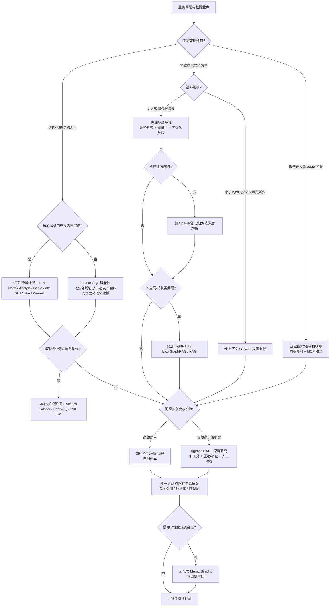
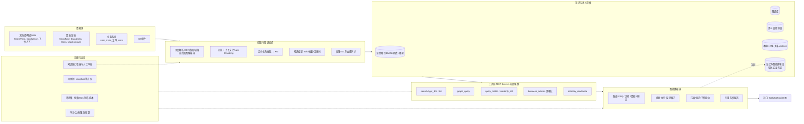

# 企业知识库实施策略深度研究报告（2026-10-14）

> 范围：模型能力提升对智能体与知识库设计的影响（第 13 章专章）；非结构化文档 RAG（朴素/进阶/多模态）、图谱类 RAG（GraphRAG / LightRAG / KAG / 知识图谱）、Agentic RAG 与深度研究式检索、长上下文 / CAG、"与数据对话"（Text-to-SQL、语义层/指标层、Chat BI）、本体驱动（Palantir Ontology、Microsoft Fabric IQ、RDF/OWL、数据产品）、MCP 连接器联邦与企业搜索（Glean、M365 Copilot、Gemini Enterprise、Elastic、Vertex AI Search/Agent Search）、记忆系统、微调 vs 检索，以及多种组合方案。
>
> 写作约定：
> - 所有数字、客户、案例只引用本次实际抓取过的页面，文末列出链接；方括号 `[n]` 对应参考文献编号。
> - 标注 **【未核实】** 的内容表示仅有二手线索、未能抓取原文，或本文作者的推断。
> - 标注 **【经验建议】** 的规模阈值、成本等级是工程经验估计，不是基准测试结论，落地前应用自家数据评测。
> - 厂商自报数据（如"90%+ 准确率"）均为厂商内部评测，口径不同，不能横向直接比较。
> - 时间以北京时间（UTC+8）为准；GitHub Star 数为 2026-10-14 通过 GitHub API 读取的数值。

---

## 0. 执行摘要

1. **没有"一招通吃"的方案。** 企业知识通常分三类：①非结构化文档（制度、手册、合同、工单），②结构化数据（数仓表、指标），③跨系统的业务对象和流程（客户、订单、设备、审批）。三类分别对应的主力技术是 **RAG**、**语义层 + Text-to-SQL**、**本体/知识图谱 + 工具调用**。成熟架构是"多路由 + 统一治理"。
2. **RAG 的提升主要来自检索工程，换模型的作用排在其后。** Anthropic 的实验里，Contextual Embeddings + Contextual BM25 + Rerank 把 top-20 检索失败率从 5.7% 降到 1.9%（降 67%）[1]。ColPali 论文也指出，工业场景的主要瓶颈在文档摄取流水线，不在 embedding 模型本身 [11]。
3. **Text-to-SQL 学术榜单进步很快，但"原始 schema 直接问"在企业里仍不可靠。** BIRD 测试集最优 82.95%，人类 92.96% [3]。Spider 2.0-Snow 最优 96.70%，但 Spider 2.0-Lite 只有 76.23%，DBT 任务 65.6% [2]。企业要稳定可用，基本都离不开**语义模型/指标层/知识图谱**：data.world 基准中 GPT-4 零样本 SQL 准确率 16.7%，换到知识图谱表示后为 54.2% [4]；Snowflake 报告语义模型让同一 LLM 在 4 个 BIRD 子库上的平均准确率从 57% 提到 78% [16]。
4. **GraphRAG 适合"全局性/关联性"问题，但索引成本高。** 微软 GraphRAG 在百万 token 级语料的全局摘要类问题上明显优于朴素 RAG [6]。LazyGraphRAG 把索引成本降到与向量 RAG 相当，即完整 GraphRAG 的 0.1% [7]。系统评测显示 RAG 与 GraphRAG 各有所长，组合使用效果最好 [9]。
5. **长上下文/CAG 适合小而稳定的知识库。** Anthropic 建议知识库小于约 20 万 token（约 500 页）时可以直接放进 prompt，配合提示缓存 [1]。研究表明长上下文在资源充足时平均效果优于 RAG，但成本高得多；Self-Route 路由可以兼顾两者 [13]。超过 64k token 后，只有少数模型能保持稳定准确率 [14]。
6. **企业搜索/连接器联邦正在向 MCP 收敛。** M365 Copilot 同时提供"同步连接器（索引进 Microsoft Graph）"和"联邦连接器（基于 MCP 实时访问）"两种模式 [23][24]。Glean 用连接器把内容、活动信号和权限归一化到企业知识图谱 [25]。Google 已把 Agentspace 并入 Gemini Enterprise（2025-10-09 发布）[27]。
7. **模型能力提升让知识库从"被动语料库"变成"智能体的工作环境"（见第 13 章）。** METR 测得智能体可完成任务的时长约每 7 个月翻一番 [52]，GPT-5 智能体时间视野约 2 小时 17 分 [53]。Deep research 类产品可以做 5–30 分钟的多步研究，并接入 MCP [54]；多智能体研究比单智能体高 90.2%，但 token 消耗约为对话的 15 倍 [32]。知识库因此需要：以 MCP 工具形式暴露、支持多轮自适应检索、可写记忆/笔记（需审核分区）、以语义层/本体作为动作空间、轨迹级评测，以及在工具层强制权限。
8. **中国企业在 Text-to-SQL/数据智能体榜单上非常活跃**：腾讯、字节、蚂蚁、阿里、华为、京东、小米、快手、美团等都有提交 [2][3]。知识库产品侧有阿里云百炼、腾讯 WeKnora、火山引擎 Viking 知识库、华为云 KooSearch 等，并有可查证的客户案例 [38][40][41][42]。

---

## 1. 企业知识的分层模型与评估口径

| 层 | 典型载体 | 主要问题类型 | 主力技术 |
|---|---|---|---|
| L1 非结构化文档 | PDF/Word/PPT/Wiki/邮件/工单/图片扫描件 | "制度怎么规定""故障怎么处理" | RAG（混合检索、重排、上下文化分块、多模态） |
| L2 半结构化/关系型知识 | 实体、关系、事件、主题 | "A 和 B 有什么关系""全库有哪些主题" | GraphRAG / LightRAG / KAG / 知识图谱 |
| L3 结构化数据 | 数仓表、指标、维度 | "上季度华东毛利率""Top10 客户" | 语义层/指标层 + Text-to-SQL / Chat BI |
| L4 业务对象与动作 | 客户、订单、设备、审批流 | "把这批延误订单重新排产" | 本体（Ontology）+ 工具/动作 + 智能体 |
| L5 个人/会话上下文 | 偏好、历史对话、任务状态 | "按我上次的口径再算一遍" | 记忆系统（Mem0、Graphiti 等） |
| 横切 | 权限、审计、血缘、评测 | — | 企业搜索/连接器治理、MCP、评测集 |

**评估口径提醒**：
- 检索层用 Recall@k / nDCG@k / 检索失败率（1-recall@k）[1][11][12]。
- 生成层用忠实度、引用正确率、LLM-as-judge 胜率。GraphRAG/LightRAG 论文主要用 LLM 裁判的成对胜率 [5][8]，**不是**事实准确率。
- Text-to-SQL 用执行准确率（EX）；BIRD 另有效率指标 R-VES [3]。
- 厂商"准确率"多为内部数据集，不可横向比较。

---

## 2. 非结构化文档：朴素 RAG → 进阶 RAG

### 2.1 朴素 RAG（Naive / Baseline RAG）
- **机制**：文档切成数百 token 的块 → 向量化 → 向量库相似度检索 → top-k 拼进 prompt 生成 [1]。
- **优点**：实现简单，开源框架开箱即用（LangChain、LlamaIndex、Dify、FastGPT 等）。可以低成本扩展到远超上下文窗口的语料规模 [1]。
- **缺点**：
  - 分块会丢失上下文：例如 "公司营收增长 3%" 这样的块，看不出是哪家公司、哪个季度 [1]。
  - 纯向量检索会漏掉精确匹配，例如错误码 "TS-999" [1]。
  - 无法回答需要跨文档"连点成线"或全局主题归纳的问题 [5]。
- **成本/复杂度**：低。
- **规模适配【经验建议】**：数百到数十万文档、GB 级文本；以非结构化为主（>80%）的 FAQ/制度问答。
- **场景**：内部制度问答、客服 FAQ、产品手册。
- **案例**：
  - 申通快递基于阿里云百炼工作流 + KnowledgeStudio 知识库，完成文档批量导入、语义向量检索、意图识别，简单问题由 AI 作答，复杂问题转人工工单，并接入钉钉。平均首次回复 4.41 秒，即时满意度超 96%，覆盖 35 万生态员工的内部咨询 [38]。
  - 橡楚橡胶（火山引擎豆包 + VikingDB/Milvus）官网客服：FAQ 命中率从约 40% 升到 92%，技术咨询人工转接率下降约 55% [41]。该文为开发者社区文章，数据为作者自报。

### 2.2 进阶 RAG 的关键技术

| 技术 | 机制 | 证据 | 成本 |
|---|---|---|---|
| **混合检索 BM25 + 向量** | 词法检索与语义检索并行，用 RRF 或线性加权融合 | Anthropic：Embeddings+BM25 优于单独 Embeddings [1]；Elastic 对比了 Convex Combination 与 RRF：RRF 无需分数校准，CC 调好权重可以更好 [30]；Elastic 另有学习型稀疏模型 ELSER [30] | 低 |
| **重排（Rerank）** | 先召回 top-N（如 150），再用 cross-encoder 精排取 top-K（如 20） | 在 Contextual Retrieval 基础上，失败率从 2.9% 再降到 1.9% [1]；会增加延迟和成本，需要权衡 [1] | 低-中 |
| **查询改写/分解** | HyDE、RQ-RAG 子问题分解、提示扩写 | LightRAG 论文以 RQ-RAG、HyDE 为基线 [8]；Uber QueryGPT 发现用户提问常常信息不足，需要 "prompt enhancer" [36]；华为 KooSearch 宣称含查询改写/分解与复杂 Query 判定 [43] | 低-中 |
| **分块策略** | 固定长度、按句/段、语义分块、父子分块、按标题/版面 | Late Chunking 论文：固定 256 token / 5 句 / 语义分块三种方式的平均 nDCG 差异不大（52.2–52.4），重叠 16 token 没有明显收益 [12]；WeKnora 支持父子分块 [40] | 低 |
| **Contextual Retrieval** | 用 LLM 为每个块生成 50–100 token 的"所在文档上下文"前缀，再做 embedding 和 BM25 | 失败率降 35%（仅 embedding）/ 49%（+BM25）/ 67%（+rerank）[1]；借助提示缓存，一次性成本约 $1.02/百万文档 token [1] | 中（索引期 LLM 调用） |
| **Late Chunking** | 先用长上下文 embedding 模型编码整篇文档，再按块做 mean pooling | 在 BeIR 子集上相对朴素分块平均提升约 2.7%–3.6%（nDCG@10）[12]；无需额外 LLM，成本低于 Contextual Retrieval [12] | 低 |
| **ColBERT 多向量 / 晚交互** | 每个 token 一个向量，MaxSim 打分 | 精度高，但存储与检索开销更大 [11][12] | 中 |
| **ColPali 多模态文档 RAG** | 直接把页面图像编码成多向量，跳过 OCR/版面分析/图注 | ViDoRe 上平均 nDCG@5 为 81.3，最强文本流水线约 65–67；ColQwen2 达 86.6 [11]；索引每页 0.39 秒，Unstructured+图注流水线为 7.22 秒 [11]；每页约 257.5KB 存储，可通过池化/量化压缩 [11] | 中（GPU、存储） |
| **深度文档解析** | 版面分析、OCR、表格识别 | RAGFlow 以 "Quality in, quality out" 为核心，DeepDoc 负责版面/OCR/表格 [44] | 中 |

**进阶 RAG 小结**
- **优点**：Contextual Retrieval、混合检索、重排三者叠加的收益已有量化证据 [1]，投入产出比最高，应作为企业 RAG 的默认基线。
- **缺点**：仍然不擅长全局归纳、多跳推理和数值聚合。数值聚合应交给 SQL。
- **规模【经验建议】**：10 万到千万级 chunk；含大量扫描件或图表时，考虑 ColPali 类视觉检索。
- **案例**：
  - 华为云 KooSearch：齐心集团 CTO 公开分享，商品智能检索匹配准确率达 97% 以上，问答准确率由此前方案的 60%–70% 提升到 96% 以上（2024 华为开发者大会演讲转述）[42]。
  - 同方知网与华为云共建 RAG 知识管理服务 [42]。
  - Anthropic 的实验覆盖代码库、小说、ArXiv 论文、科学论文等多领域 [1]。

---

## 3. 图谱类 RAG：GraphRAG / LightRAG / KAG / 知识图谱 RAG

### 3.1 Microsoft GraphRAG
- **机制**：LLM 从全量语料抽取实体和关系，构建知识图谱 → 自底向上做社区聚类 → 为每个社区预生成摘要 → 查询时用社区摘要做 map-reduce 式回答（全局搜索），或基于实体邻域回答（本地搜索）[5][6]。
- **优点**：
  - 能"连点成线"：基线 RAG 回答不了的 "Novorossiya 做了什么" 被 GraphRAG 答出，并附实体/关系溯源 [5]。
  - 能回答"数据集前 5 大主题"这类全局问题 [5]。
  - 在约百万 token 级语料的全局问题上，全面性与多样性显著优于基线 RAG [6]。
  - 忠实度与基线 RAG 相近 [5]。
- **缺点**：
  - 索引需要 LLM 遍历全量语料，成本高。
  - 增量更新困难：LightRAG 论文估算，在 Legal 数据集上 GraphRAG 有 1,399 个社区，增量更新时需重建社区报告，约 1,399×2×5,000 token；一次全局检索约消耗 610×1,000 token [8]。
  - 评测多为 LLM 裁判胜率，不是事实准确率 [5][6]。
- **改进：LazyGraphRAG**：把昂贵的 LLM 摘要推迟到查询时。索引成本与向量 RAG 相同，为完整 GraphRAG 的 0.1%；在全局查询上质量与 GraphRAG 全局搜索相当，查询成本低 700 倍以上 [7]。
- **开源**：microsoft/graphrag，约 3.6 万 Star，MIT [G]。

### 3.2 LightRAG（港大 HKUDS）
- **机制**：从块中抽取实体/关系并生成 KV 摘要，做"低层（实体）+ 高层（主题关系）"双层检索，图结构与向量结合；新文档只做图的并集合并，支持增量更新 [8]。
- **证据**：在 UltraDomain 的 Agriculture/CS/Legal/Mix 四个数据集（每个 61 万–508 万 token）上，LightRAG 对 NaiveRAG 的 Overall 胜率为 60%–84.8%，对 GraphRAG 为 49.6%–54.8%，基本持平略优 [8]。检索阶段约 <100 token、1 次 API 调用 [8]。
- **开源**：HKUDS/LightRAG，约 4.0 万 Star，MIT [G]。

### 3.3 KAG（蚂蚁集团 / OpenSPG）
- **机制**：LLM 友好的知识表示 + 知识图谱与原文块互索引 + 逻辑形式（logical form）引导的混合推理引擎 + 语义对齐 [35]。
- **证据**：多跳问答 F1 相对 SOTA 提升，2wiki 提升 19.6%，HotpotQA 提升 33.5%。已用于蚂蚁集团政务问答与医疗问答两个专业场景，专业性相对 RAG 显著提升 [35]。
- **开源**：OpenSPG/KAG，约 9.1 千 Star，Apache-2.0 [G]。

### 3.4 RAG vs GraphRAG 的系统评测
- 统一评测协议下，RAG 与 GraphRAG 在不同任务和评测视角上各有优势；选择或融合两者能带来一致提升 [9]。**结论：GraphRAG 不应替代向量 RAG，而应与之组合使用。**

**图谱类 RAG 小结**
- **适用规模【经验建议】**：语料在百万到数千万 token、实体关系密集（法律、情报、科研、供应链、医疗）时值得做；文档少于千篇且问题以事实查找为主时，性价比低。
- **成本**：GraphRAG 高；LightRAG/LazyGraphRAG 中低；KAG 中高（需要 schema 与推理引擎）。
- **场景**：调查分析、合规关联、专利/科研综述、政务/医疗专业问答 [35]。

---

## 4. Agentic RAG 与"深度研究"式检索

- **机制**：让 LLM 智能体自主规划，分解问题 → 多轮调用检索/SQL/网页等工具 → 反思后再检索 → 汇总并引用。可以是单智能体循环，也可以是"主智能体 + 并行子智能体"。
- **证据**：
  - Anthropic 多智能体研究系统：Opus 4 主智能体 + Sonnet 4 子智能体，在内部研究评测上比单智能体 Opus 4 高 90.2%。代价是 token 消耗约为普通对话的 15 倍（单智能体约 4 倍）。在 BrowseComp 中，token 用量单独解释了 80% 的性能方差 [32]。
  - RAGFlow 在 2026-08-19 引入 Agentic RAG，提供 Low/Medium/High/Ultra 四档思考模式，支持多步检索与问题分解 [44]。
  - 阿里云百炼知识库 2026-07-16 的社区文章以 "Agentic RAG 4.0" 为题 [39]（页面正文抓取不全，具体能力细节**【未核实】**）。
  - Databricks Genie GA 公告提到 "Genie Deep Research" [18]。
- **优点**：能处理多跳、开放式、跨源问题，也能自我纠错（Uber、LinkedIn 的 SQL 智能体都用了 EXPLAIN/校验类自纠正 [36][37]）。
- **缺点**：延迟和成本成倍增加 [32]；行为不确定，评测与可观测性要求更高（Uber 指出同一评测重复运行会有约 5% 的波动 [36]）。
- **规模/场景【经验建议】**：适合高价值、低频的复杂研究型问题，例如尽调、竞品、合规调查。高频简单 FAQ 不应走 agentic 路径，否则成本失控。

---

## 5. 长上下文 / CAG（缓存增强生成） vs RAG

- **CAG 机制**：把全部知识预先加载进长上下文，预计算 KV Cache，推理时只处理问题；会话间截断追加的 token 即可复位 [10]。
- **证据**：
  - CAG 论文用 Llama 3.1 8B 在 SQuAD/HotPotQA（2.1 万–8.5 万 token）上测试，多数配置 BERTScore 高于稀疏/稠密 RAG。HotPotQA-Large 上 CAG 生成耗时 2.26 秒，而动态塞入上下文需要 92.08 秒 [10]。论文同时承认语料变大后优势缩小，大规模数据集不适用 [10]。
  - Anthropic：知识库小于约 20 万 token（约 500 页）时可以整体放进 prompt。提示缓存可降低延迟 2 倍以上、成本最多 90% [1]。
  - Li et al.（EMNLP 2024 Industry）：资源充足时长上下文的平均效果持续优于 RAG，但 RAG 成本显著更低；Self-Route 由模型自我反思决定走 RAG 还是长上下文，在接近长上下文效果的同时大幅降低成本 [13]。
  - Databricks（Leng et al.）：在 2k–128k（部分到 2M）token 上测试 RAG，检索更多文档可以提升效果，但只有少数最新模型能在 64k 以上保持稳定准确率 [14]。
- **选择【经验建议】**：
  - 语料小于约 20 万 token、更新不频繁、需要全局通读（如单份合同、产品手册、SOP 集合）时，优先 CAG/长上下文。
  - 语料达到百万 token 以上、更新频繁、有权限过滤需求时，必须用 RAG。
  - 两者之间用 Self-Route 式路由 [13]。
- **局限**：长上下文不解决权限隔离。每个用户可见的文档集合不同，导致缓存难以共享（推断，**【未核实】**）。

---

## 6. "与数据对话"：Text-to-SQL、语义层/指标层与 Chat BI

### 6.1 基准现状

| 基准 | 规模 | 最新成绩（2026-10 抓取） | 备注 |
|---|---|---|---|
| BIRD | 12,751 问答对、95 个库、33.4GB、37 个领域 [3] | 人类 92.96%；GrainSQL 82.95%；华为 2012 实验室 DataGallery 82.39%；腾讯 SiriusAI 82.28%；AT&T AskData 81.95%；蚂蚁 Agentar-Scale-SQL 81.67%；小米 80.83%；阿里云 XiYan-SQL 75.63%；GPT-5.5-xhigh 单模型 72.55%；Claude Opus 4.6 基线 70.15% [3] | 含脏数据、外部知识、SQL 效率 |
| Spider 2.0 | 632 个真实企业工作流问题，数据库常超 1,000 列，SQL 常超 100 行 [2] | Snow 榜：Genloop 96.70%；腾讯云大数据 TCDataAgent 93.97%；AT&T CDO & RelationalAI（关系知识图谱）86.28%；字节 ByteBrain-Agent 84.10%；蚂蚁 Deepinsight 83.00%；阿里 CFO 技术 AiCheng 82.81%；Snowflake Arctic-FLEX 75.14% [2]。Lite 榜：腾讯天穹 Data Agent + GLM 5.2 76.23%。DBT 榜：SignalPilot 65.6% [2] | 2024 年发布时 o1-preview 仅解决 17.1%，GPT-4o 10.1% [2] |
| data.world 企业 KG 基准 | 保险领域企业 schema，43 个问题 [4] | GPT-4 零样本 SQL 16.7%，基于 KG/SPARQL 54.2%；高 schema 复杂度问题上 SQL 为 0%，KG 为 35.7%–38.5% [4] | dbt Labs 用同一题集复现：8 个可回答问题达 83% [17] |

**解读**：
- 两年内 Spider 2.0 榜单从约 10% 提升到 90%+ [2]，提升主要来自"智能体 + 上下文工程 + 元数据/知识图谱"，而不是单一模型。
- 但 Snow 设定"自带完善的元数据与文档"[2]。真实企业的元数据质量往往达不到这个水平，因此**语义层、元数据治理和评测集**才是企业落地的关键。

### 6.2 语义层 / 指标层（dbt Semantic Layer、Cube、Snowflake 语义视图、Databricks UC Metrics、Power BI 语义模型）
- **机制**：把度量、维度、口径、Join 关系、同义词、已验证查询沉淀为可复用模型。LLM 生成的是"指标查询"或受约束的 SQL，而不是直接面对原始 schema。
- **证据**：
  - Snowflake Cortex Analyst 报告在真实 BI 场景达到 90%+ SQL 准确率，约为 GPT-4o 单次提示的 2 倍，比市面其他方案高约 14%（内部评测）[15]。语义模型保证用户定义的度量与过滤条件被一致应用 [15]。用 Cortex Search 检索列中的字面量（literal），解决过滤值匹配问题 [46]。
  - Snowflake 的智能体自动改进语义模型：同为 Claude 3.5 Sonnet，在 BIRD 的 4 个库上平均准确率从 57% 提到 78% [16]。
  - dbt Labs：在 data.world 题集中，8 个可回答问题经 dbt Semantic Layer 回答准确率为 83%；需要多跳 Join 的问题被排除在外 [17]。
  - Databricks AI/BI Genie 已 GA。预览期有超过 4,000 家客户采用；提供 Benchmarks（带期望 SQL 的测试题）和 Ask for Review；支持 Unity Catalog Metrics 作为受治理的语义来源 [18]。
  - Cube Core 将自身定位为"面向 AI、BI 与嵌入式分析的开源语义层"，约 2.1 万 Star [G]。
- **优点**：口径一致、可审计、准确率高、易权限化。
- **缺点**：前期建模投入大，覆盖不到的长尾问题仍需回退到 Text-to-SQL；多跳 Join 与复杂指标仍是难点 [17]。
- **X 平台讨论（观点，非独立证据）**：
  - Strategy（MicroStrategy）称其 Mosaic 语义层在 28 表保险模型的 17 个问题上 17/17 正确（厂商自测）[X1]。
  - 社区帖子普遍认为"ad hoc 小数据用 Text-to-SQL，关键指标和复杂数据用语义层"[X2]。

### 6.3 企业 Text-to-SQL 智能体实践
- **Uber QueryGPT**：
  - 背景：平台每月约 120 万次交互式查询，单条手写约 10 分钟，QueryGPT 生成约 3 分钟 [36]。
  - 架构：业务域 Workspace（如 Mobility、Ads 等 12 个系统工作区）→ Intent Agent → Table Agent（用户确认表）→ Column Prune Agent（大表可达 200+ 列、4–6 万 token）[36]。
  - 效果：有限发布阶段日活约 300，78% 的用户认为节省了时间 [36]。
  - 结论：LLM 擅长做"小而专"的分类任务；幻觉问题仍未完全解决 [36]。
- **LinkedIn SQL Bot**（DARWIN 平台）：利用查询日志统计表/字段热度和常用 Join，引入认证过的 notebook 示例；调研中约 95% 的用户评价准确率"合格及以上"[37]。
- **开源**：
  - Vanna 2.0：面向用户身份感知的智能体，支持 RAG/记忆等 Context Enrichers，约 2.4 万 Star，MIT [G][47]。
  - WrenAI：开源 GenBI 引擎，为 Claude Code/Cursor/MCP 客户端等提供受治理的语义层（MDL）与 AI 上下文层，含 dry-plan 校验、值画像等护栏，约 1.8 万 Star [45][G]。
  - 阿里 XiYan-SQL：多生成器集成，约 1 千 Star [G]，BIRD 75.63% [3]。

### 6.4 Chat BI 小结

| 方案 | 准确率特征 | 成本 | 规模适配【经验建议】 |
|---|---|---|---|
| 原始 schema + LLM 单次生成 | 低且不稳定（data.world 16.7% [4]） | 低 | <20 张干净表、探索性分析 |
| RAG 选表 + 智能体（Uber/LinkedIn 式） | 中-高，依赖元数据与示例 [36][37] | 中 | 数百到数十万表，按业务域切分 |
| 语义层/指标层 + LLM | 高（厂商报告 78%–90%+ [15][16][17]） | 中-高（建模） | 核心指标数十到数千个 |
| 知识图谱/本体 + LLM | 高，可做确定性纠错 [4] | 高 | 跨域、复杂关系的数仓 |

---

## 7. 本体驱动方案：Palantir Ontology、Microsoft Fabric IQ、RDF/OWL、数据产品

### 7.1 Palantir Foundry / AIP Ontology
- **机制**：Ontology 是组织的"数字孪生"，包含语义要素（对象、属性、链接）和动态要素（动作 Actions、函数、动态安全）[20]。AIP 智能体基于对象和动作工作，而不是直接读写表。
- **案例（Palantir 官方 AIPCon 材料，厂商口径）**：
  - **Tyson Foods**：用 Foundry + AIP Logic（GPT-4o）+ Ontology/OSDK 自动把遗留平台 ACE 的代码翻译成 dbt，人工审核把关。原计划 10–15 人做 3 年，实际 1 人 3–4 个月完成 [21]。
  - **Aramark**（覆盖 15 国、20 万员工、年供餐 20 亿份）：用 LLM 做商品匹配，30% 的初始匹配置信度达到 99%，置信度 >99% 的部分实现自动化。借助 Ontology 打通采购与销售两端的数据血缘。99% 的商品实现自动分类，剩余 1% 人工处理 [22]。
- **优点**：语义与动作一体，权限细到对象级，适合"决策 + 执行"闭环。
- **缺点**：平台锁定，实施重（通常需要 FDE/Bootcamp），成本高（具体价格**【未核实】**）。

### 7.2 Microsoft Fabric IQ Ontology（已核实存在，目前为 Preview）
- 微软 Learn 文档显示："Microsoft Fabric IQ 中的 ontology（preview）项提供业务的共享、机器可理解表示"，定义客户、产品、资产、订单、地点等概念及其属性与关系 [19]。
- 支持实体类型、无键实体、无需中间表的关系、命名空间、层次与继承，并可从 Power BI 语义模型生成 [19]。
- 检索摘要称 Fabric IQ 于 Ignite 2025 发布、2026 年 6 月 GA 而 ontology 仍为 preview：Fabric 博客被反爬拦截，未能抓取原文，**【未核实】**。

### 7.3 知识图谱 / 语义网（RDF/OWL/R2RML/SPARQL）
- data.world 基准用 OWL 本体 + R2RML 映射把 SQL 库表示成知识图谱，准确率从 16.7% 提升到 54.2% [4]。
- 同一团队后续论文称，利用本体做确定性纠错后准确率达 72.55%：该数字来自检索摘要，PDF 抓取超时，**【未核实】**。
- 2026 年 BIRD Mini-Dev 榜出现 "Ontology2SQL"（SQLite 70.20%）[3]，Spider 2.0-Snow 榜有 AT&T 与 RelationalAI 的"关系知识图谱"方案（86.28%）[2]，说明"本体/KG + SQL"正在进入主流竞赛。

### 7.4 数据产品（Data Products）
- 把语义层、本体、质量 SLA、负责人打包成可发现的数据产品，作为智能体可调用的"受治理工具"。
- 这是本文的架构建议，未找到可量化的公开基准，**【经验建议】**。

**本体方案小结**：成本高、周期长；适合高价值运营决策（供应链、制造、医疗、国防、能源）。规模上适用于跨数十个系统、业务对象上百类的组织【经验建议】。

---

## 8. MCP 连接器联邦与企业搜索

### 8.1 MCP（Model Context Protocol）
- 开放协议，基于 JSON-RPC 2.0。Host、Client、Server 三方通过能力协商交互；Server 提供 Resources（上下文数据）、Prompts（模板）、Tools（可执行函数）[31]。
- 官方 servers 仓库约 9.1 万 Star [G]。
- WeKnora 内置 MCP Server，可接入外部 MCP 服务（支持 OAuth）[40]。WrenAI 面向 MCP 客户端提供语义层 [45]。

### 8.2 主要企业搜索平台

| 平台 | 机制 | 已核实要点 |
|---|---|---|
| **Microsoft 365 Copilot / Graph** | 同步连接器把外部内容索引进 Microsoft Graph，做语义索引，并按源系统权限过滤；联邦连接器用 MCP 实时访问外部系统 [23][24] | 两种模式并存：同步模式适合可搜索的知识库，联邦模式适合实时/受监管数据 [23][24] |
| **Glean** | 100+ 连接器把内容、活动信号、权限集合归一化后送入 Glean Knowledge Graph，支撑 Search、Chat（RAG）、Assistant；支持索引、实时检索与混合模式 [25] | Confluent：知识散落在 20+ 系统，上线后每月节省 15,000+ 小时，支持团队对信息获取的满意度提升 13%（厂商案例）[26] |
| **Google Gemini Enterprise**（原 Agentspace） | 2025-10-09 发布，连接 Workspace、M365、Salesforce、SAP 等，配中心化治理 [27]；连接器覆盖 Confluence、Jira、SharePoint、Teams、Box 等，多数支持"搜索 + 执行动作" [28] | 官方博客点名使用 Google Cloud AI 产品的客户包括 Banco BV、DBS Bank、Deutsche Telekom 等（指 Google Cloud AI 产品整体，不专指 Gemini Enterprise）[27] |
| **Vertex AI Search → Agent Search** | 现名 "Agent Search on Gemini Enterprise Agent Platform（原 Vertex AI Search）"，支持网站、结构化与非结构化数据搜索，提供开箱即用的 grounding 与 RAG [29] | — |
| **Elastic** | BM25 + 稠密向量 + ELSER 稀疏向量，用 RRF/CC 融合 [30] | 常见的自建混合检索底座 |
| **国内** | 华为云 KooSearch（稀疏+向量混合、查询改写/分解、生成后验、多模态）[43]；阿里云百炼 KnowledgeStudio [38]；火山引擎 VikingDB 知识库 [41]；腾讯 WeKnora（飞书/Confluence/GitLab 等数据源，企业微信/飞书/Slack 渠道）[40] | 见第 2 节案例 |

- **优点**：权限感知、开箱即用、覆盖面广，可以快速"让员工找得到"。
- **缺点**：
  - SaaS 订阅成本高（具体价格**【未核实】**）。
  - 深度结构化分析弱，需要另配语义层。
  - 同步索引存在延迟与合规顾虑，联邦（MCP）模式则受限于源系统的检索质量与限流（推断）。

---

## 9. 记忆系统（Memory）
- **机制**：从对话中抽取、更新、合并"事实/偏好"，持久化存储，按需检索；可以用图结构表示时间与关系。
- **证据**：Mem0 在 LOCOMO 基准上，LLM-as-Judge 指标相对 OpenAI 记忆提升 26%；图记忆版本再高约 2%；相对全上下文方案，p95 延迟降低 91%，token 成本节省 90% 以上 [33]。
- **开源**：mem0（约 6.7 万 Star，Apache-2.0）、getzep/graphiti（"为智能体构建实时知识图谱"，约 3.2 万 Star）[G]。WeKnora 提供跨会话长期记忆 [40]。
- **定位**：记忆是"个人/会话层"的知识，不能替代企业知识库，需要与权限体系、遗忘/更正机制配合使用。

---

## 10. 微调 vs 检索
- **证据**：Ovadia et al. 在多类知识密集任务上发现，RAG 稳定优于无监督微调，无论是训练中见过的旧知识还是全新知识；LLM 很难通过无监督微调学会新事实，对同一事实提供多种表述可以缓解 [34]。
- **实践信号**：
  - Tyson 案例明确称"无需额外微调成本"，而是通过分析历史翻译生成规则与示例 [21]。
  - BIRD"单模型赛道"上，Snowflake Arctic-Text2SQL-R1、Databricks RLVR 32B、腾讯 SiriusAI-SQL-27B/9B 等通过 RL/SFT 把 7B–32B 模型推到 70%–78% [3]。说明**窄任务（如 SQL 方言、领域格式）适合微调**，事实知识更适合检索。
- **建议【经验建议】**：先做 RAG + 语义层。当遇到以下情况时再考虑微调 embedding/reranker/小模型：①需要私有化小模型降本；②有特定输出格式或 DSL；③有大量高质量标注。ColPali 论文也显示，加入 1,552 条法语表格样本后 TabFQuAD 有提升 [11]。

---

## 11. 组合方案

### 11.1 RAG + Text-to-SQL 路由
- **机制**：意图分类器或 LLM 路由把问题分为"文档类 / 指标类 / 混合类"，混合类先查 SQL 再查文档解释，或反过来。
- **证据**：
  - Uber 的 Intent Agent 把问题映射到业务域，大幅缩小检索范围 [36]。
  - Snowflake 把 Cortex Search（模糊检索列值）与 Cortex Analyst（语义模型 SQL）结合，解决字面量匹配问题 [46]。
  - Self-Route 证明"自我反思式路由"能在保持效果的同时降低成本 [13]。
- **成本**：中。**场景**：经营分析助手（"为什么华东毛利下降？"需要数据加上周报原文）。
- **风险**：路由错误会连带出错，需要对路由单独评测（推断）。

### 11.2 本体/知识图谱 + RAG
- **机制**：本体提供实体、关系和口径；RAG 提供原文证据；KG 与文本块互相索引（KAG 的 mutual-indexing [35]）。
- **证据**：KAG 在多跳问答上 F1 提升 19.6%/33.5%，并已用于蚂蚁政务/医疗问答 [35]；data.world 中 KG 让 SQL 问答准确率提升 37.5 个百分点 [4]。
- **成本**：高。**场景**：医疗、政务、金融合规、制造设备知识。

### 11.3 语义层 + 智能体
- **机制**：语义层作为工具（API/MCP）暴露给智能体，智能体只能查询受治理的指标，并可调用图表、报表、告警等动作。
- **证据**：Cortex Analyst 本身就是"多智能体 + 语义模型"[15]；WrenAI 向 MCP 客户端暴露受治理的语义层 [45]；Genie 以 Unity Catalog Metrics 为语义源 [18]；Fabric IQ ontology 面向数据智能体与运营智能体（Learn 文档语境）[19]。
- **成本**：中-高。**场景**：自助分析、经营驾驶舱、指标异动归因。

### 11.4 GraphRAG + 向量 RAG
- **机制**：事实型/局部问题走向量检索，全局/关联问题走图检索，或者把图的邻域块与向量块融合。
- **证据**：
  - LightRAG 本身即"图 + 向量"[8]。
  - LazyGraphRAG 在接近向量 RAG 的成本下，局部查询优于对比方法 [7]。
  - RAG vs GraphRAG 系统评测证实融合策略带来一致提升 [9]。
  - WeKnora 同时提供混合检索、重排与 GraphRAG（Neo4j）[40]。
- **成本**：中。

### 11.5 混合联邦搜索 + 智能体
- **机制**：企业搜索（同步索引）承担广覆盖的召回，MCP 联邦连接器承担实时与事务数据访问，智能体负责编排和执行动作。
- **证据**：M365 Copilot 同步与联邦两种连接器并存 [23][24]；Gemini Enterprise 连接器同时支持搜索与动作 [28]；Glean 有索引、实时检索、混合三种访问模式 [25]。
- **成本**：中-高（SaaS 订阅或自建连接器治理）。

---

## 12. 开源框架速览（GitHub 数据于 2026-10-14 读取）

| 项目 | 定位（摘自仓库描述/README） | Star | 许可 |
|---|---|---|---|
| langchain-ai/langchain | "The agent engineering platform" | ~14.8 万 | MIT |
| run-llama/llama_index | "document processing platform for AI" | ~5.2 万 | MIT |
| langgenius/dify | 开源 LLM 应用平台：工作流、RAG 管线、Agent、可观测性 [48] | ~15.8 万 | 自定义（NOASSERTION） |
| infiniflow/ragflow | 深度文档理解 RAG 引擎，DeepDoc，Agentic RAG [44] | ~9.2 万 | Apache-2.0 |
| labring/FastGPT | 基于 LLM 的知识库平台 | ~3.0 万 | 自定义 |
| deepset-ai/haystack | 生产级 LLM 编排框架 | ~2.7 万 | Apache-2.0 |
| microsoft/graphrag | 模块化图 RAG | ~3.6 万 | MIT |
| HKUDS/LightRAG | 简单快速的图 RAG（EMNLP 2025） | ~4.0 万 | MIT |
| OpenSPG/KAG（蚂蚁） | 逻辑形式引导的推理与检索 | ~9.1 千 | Apache-2.0 |
| Tencent/WeKnora（腾讯） | 文档 → RAG、智能体、Wiki 的知识平台 [40] | ~3.4 万 | 自定义 |
| Canner/WrenAI | GenBI、受治理的 Text-to-SQL 语义层 [45] | ~1.8 万 | 自定义 |
| vanna-ai/vanna | 与 SQL 数据库对话的智能体 [47] | ~2.4 万 | MIT |
| cube-js/cube | 开源语义层 | ~2.1 万 | 自定义 |
| mem0ai/mem0 | 智能体记忆层 | ~6.7 万 | Apache-2.0 |
| getzep/graphiti | 智能体实时知识图谱 | ~3.2 万 | Apache-2.0 |
| illuin-tech/colpali | ColPali/ColQwen 训练与推理 | ~2.8 千 | MIT |
| stanford-futuredata/ColBERT | 晚交互检索 | ~3.9 千 | MIT |
| XGenerationLab/XiYan-SQL（阿里） | 多生成器 NL2SQL | ~1.0 千 | Apache-2.0 |

> Star 数只反映社区热度，不代表生产成熟度。部分项目的许可为自定义条款（GitHub 显示 NOASSERTION），商用前需阅读 LICENSE。

---

## 13. 专章：模型能力提升如何增强智能体执行力，以及给企业知识库带来的新特性

> 本章回答两个问题：(1) 智能体侧，近两年模型在反思纠错、自主研究、长程任务、迭代循环、工具使用、规划方面有哪些**可量化**的进步；(2) 知识库策略侧，这些进步如何改变知识库的**设计、接口、写回、治理与评测**。

### 13.1 智能体侧：能力演进与证据

| 能力 | 机制要点 | 可核实证据 |
|---|---|---|
| **推理-行动交替（ReAct）** | 交替输出"思考"和"工具调用"，根据观察结果调整计划 | ReAct 在 ALFWorld/WebShop 上，仅用 1–2 个示例就比模仿学习/强化学习方法的绝对成功率分别高 34%/10% [49] |
| **反思/自我纠错** | 失败后用语言形式的反馈写入情景记忆，再次尝试 | Reflexion 在 HumanEval 上 pass@1 达 91%，同期 GPT-4 为 80% [50] |
| **自适应检索与自我批判** | 模型自己决定何时检索，并用反思 token 评估检索段落和自身输出 | Self-RAG 提出"按需检索 + 反思 token"，推理期行为可控 [51] |
| **长程任务（task horizon）** | 用"人类专家完成时长"衡量智能体能以 50%/80% 可靠性完成的任务长度 | METR：过去 6 年 50% 时间视野约每 7 个月翻一番（2025-03 原文，页面注明部分数字已过时）[52]；GPT-5 智能体的时间视野约 2 小时 17 分 [53]；METR 2026-05 注明"当前任务集上超过 16 小时的测量不可靠"，并说明任务以软件/ML/网络安全为主，其他领域趋势相似但绝对值不同 [53] |
| **自主研究 / Deep Research** | 端到端强化学习训练的多步浏览、回溯、Python 分析，并逐句引用 | OpenAI deep research（2025-02-02）：单次任务 5–30 分钟；Humanity's Last Exam 26.6%（o1 为 9.1%）；GAIA 平均 67.36%（pass@1），此前 SOTA 为 63.64%；工具调用次数越多通过率越高；官方承认仍会幻觉、置信度校准弱 [54]。2026-02-10 更新：可连接任意 MCP/应用，并能把网页搜索限定在可信站点 [54] |
| **多智能体并行研究** | 主智能体规划，子智能体并行检索、各自压缩结果 | Anthropic：多智能体比单智能体 Opus 4 高 90.2%；token 消耗约为对话的 15 倍；BrowseComp 上 token 用量解释 80% 的方差 [32] |
| **难检索信息的持续浏览** | 在大量网页中持续搜索"纠缠"的难找信息 | BrowseComp：1,266 道需要持续导航的难题 [55] |
| **长任务的上下文管理** | 压缩（compaction）、结构化笔记、子智能体、"即时（just-in-time）"按引用加载 | Anthropic：接近上下文上限时摘要并重开新窗口；用文件系统做笔记，使智能体"随时间构建知识库、跨会话维护项目状态"；智能体只保留文件路径、存储的查询、链接等轻量标识，运行时用工具按需加载 [56] |
| **结构化数据智能体** | 规划、选表、生成 SQL、执行、自纠，循环进行 | Spider 2.0 从 2024 年 o1-preview 的 17.1% [2] 到 2026 年 Snow 榜 96.70%，前列几乎全是 "Agent" 系统（腾讯、字节、蚂蚁、阿里等）[2]；BIRD-Interact 显示交互式设定仍很难，GPT-5 在 c-Interact 上仅 8.67% [3] |
| **工具/连接器标准化** | MCP 统一 Resources/Prompts/Tools [31] | M365 Copilot 联邦连接器 [24]、OpenAI deep research [54]、WeKnora [40]、WrenAI [45] 均接入 MCP |

**关于软件工程基准**：SWE-bench 有 Verified、Multilingual、Multimodal 等多个榜单 [57]。本次抓取的页面由前端动态渲染，未能拿到具体分数，因此本报告**不引用 SWE-bench 具体数字【未核实】**。

**智能体侧小结**
- **单步能力**：工具调用和 SQL/代码生成已接近实用。
- **多步能力**：长程任务的可靠性在快速提升 [52][53]，但"50% 成功率"意味着仍需要人工验收与回退。
- **成本**：随 token 用量线性甚至超线性增长 [32]。
- **主要风险**：权威性判断弱、置信度校准差 [54]；交互式任务成功率仍低 [3]。

### 13.2 知识库策略侧：从"给 LLM 喂资料"到"给智能体提供环境"

**(1) 面向智能体的知识库（Agent-friendly KB）**
- **可导航**：目录、文件夹结构、命名、时间戳本身就是信号，智能体可以"逐层建立理解" [56]。WeKnora 上传文件夹时保留原目录结构 [40]。
- **可寻址**：每个块/文档/指标都有稳定 ID 和引用，便于 just-in-time 加载和逐句引用 [54][56]。
- **多粒度**：同时提供原文、摘要、Wiki、图谱、目录树。RAGFlow 支持在文档/数据集级"编译"出 Wiki、Graph、Tree、PageIndex、思维导图、时间线和 Skills [44]。

**(2) 以工具/MCP 暴露知识库，而非只做一次性 top-k**
- 知识库对外提供多个工具：`search(query, filters)`、`get_document(id)`、`list_folder`、`query_metric`、`run_sql(readonly)`、`graph_neighbors(entity)` 等。智能体自行组合调用（WeKnora 内置 MCP Server [40]；M365 联邦连接器 [24]）。
- 检索方式从"一次 top-k"变为"多轮检索 → 阅读 → 再检索"：RAGFlow 的 Agentic Retrieval 会分解问题、逐步检索 [44]；百炼以 "Agentic RAG 4.0" 为方向 [39]。

**(3) 知识库作为可写记忆 / 自更新**
- 智能体通过结构化笔记把中间结论写回文件或知识库，跨会话复用 [56]。
- Mem0 等记忆层负责抽取、合并、更新事实 [33]；WeKnora 支持跨会话长期记忆，以及检索分块的编辑、比对与回滚 [40]。
- **治理要点【经验建议】**：
  - 写回内容必须有"来源 = 智能体"标记、置信度和审核状态。
  - 区分"草稿区/已发布区"，防止幻觉污染权威知识。
  - 支持版本回滚（WeKnora 提供分块版本历史 [40]）。

**(4) 智能体参与知识策展与缺口检测**
- 用日志里的"无答案/低置信/被追问"问题自动生成**知识缺口清单**，交给智能体起草补充条目，再由人工审核。此为方法建议**【经验建议】**。
- 可类比的公开做法：Uber 从 QueryGPT 日志中抽取真实问题，人工校验后构建评测集 [36]；LinkedIn 只吸收经认证的 notebook 作为示例 [37]；Snowflake 用智能体自动改进语义模型，准确率 +20% [16]。

**(5) 本体/语义层成为智能体的"动作空间"**
- Palantir Ontology 的 Actions/Functions 让智能体在对象层面执行操作，并受动态安全控制 [20]。
- Fabric IQ ontology 定义业务实体、关系与规则，并与 Power BI 语义模型对齐 [19]。
- 语义层把"能查什么指标"变成受治理的工具 [15][18][45]。
- **意义**：智能体不再直接写 SQL 改表，而是调用"重新排产""创建工单"这类经过审批的业务动作，可审计、可回滚。

**(6) 评测体系升级**
- 从"单轮答案正确率"升级为**轨迹级评测**：每一步的意图、选表、调用，以及最终结果。Uber 分别评测 Intent、Table Overlap、能否运行、是否有输出、与标准 SQL 的相似度 [36]。
- 采用基准化的回归集：Genie Benchmarks [18]。
- 关注稳定性：同一评测重复运行约 5% 的波动 [36]；METR 的 50%/80% 双阈值 [53]。
- 成本指标：token、工具调用次数 [32]。

**(7) 治理与权限**
- 权限必须在**工具层**强制执行，不能只靠 prompt：M365 连接器按源系统权限过滤 [23]；Glean 归一化权限集合 [25]；Vanna 2.0 强调"每一层都感知用户身份" [47]。
- 深度研究类功能需要限定可信来源（OpenAI deep research 支持限定可信站点 [54]）。
- 写回操作、动作执行需要人工确认（Uber 的 Table Agent 让用户确认表 [36]；Tyson 案例由人工审核 [21]）。

### 13.3 "LLM + 知识库"（早期）vs "智能体 + 知识库"（当前）对比

| 维度 | 早期：LLM + 知识库（一次检索再生成） | 当前：智能体 + 知识库 | 依据 |
|---|---|---|---|
| 检索方式 | 单次 top-k 向量检索，问题原样入库检索 | 多轮、自适应：分解、改写、再检索；按需调用搜索/SQL/图/文件工具；just-in-time 加载 | [1][44][51][56] |
| 推理 | 模型只基于给定片段一次性作答 | 规划 → 行动 → 观察循环（ReAct），多跳、跨源综合 | [49][32] |
| 错误处理 | 检索失败就答错或"文中未提及" | 自我反思、重试，用 EXPLAIN/校验器自纠，失败时回退或转人工 | [50][36][37][38] |
| 任务长度 | 秒级、单轮问答 | 分钟到小时级（deep research 5–30 分钟 [54]；METR 时间视野达小时级 [53]），依赖压缩与笔记 | [53][54][56] |
| 数据类型 | 以文本块为主 | 文本 + 表格/指标（SQL/语义层）+ 图谱 + 页面图像（ColPali）+ 实时系统（MCP） | [11][15][24] |
| 写回 | 只读 | 可写：笔记/记忆/草稿知识、业务动作（Ontology Actions） | [20][33][56] |
| 成本/延迟 | 低、可预测 | 高且波动大：多智能体约 15 倍 token [32]；需要预算与路由 | [32][13] |
| 评测 | 检索召回 + 答案正确率 | 轨迹级、组件级、多次运行稳定性、成本；50%/80% 可靠性阈值 | [36][53][18] |
| 主要风险 | 幻觉、漏检、过时 | 在此之上新增：行动越权、错误写回污染知识、提示注入经工具扩散、成本失控、权威性误判 | [54][23]；部分为推断 |
| 适合问题 | FAQ、制度条款查询 | 调研报告、经营分析归因、跨系统排障、知识整理 | — |
| 知识库角色 | "被动语料库" | "智能体的工作环境 + 长期记忆 + 动作空间" | [19][20][56] |

### 13.4 给企业知识库带来的新特性清单
1. **深度研究模式**：针对内部知识与可信外部源，生成带逐句引用的报告。OpenAI deep research 已支持连接 MCP 并限定站点 [54]；Databricks 有 Genie Deep Research [18]。
2. **思考档位/成本档位**：例如 RAGFlow 的 Low–Ultra 四档 [44]，按问题价值分配 token。
3. **知识编译**：自动生成 Wiki、图谱、时间线、思维导图 [44]，以及 Wiki 知识整理 [40]。
4. **长期记忆与个性化** [33][40]。
5. **自更新语义模型/元数据**：智能体改进语义模型 [16]。
6. **动作执行**：Ontology Actions [20]；Gemini Enterprise 连接器"搜索 + 执行动作" [28]。
7. **缺口检测与知识运营看板**【经验建议】。
8. **IM 原生接入**：企业微信、飞书、钉钉、Slack [38][40]。

---

## 14. 综合对比表：策略 × 数据规模 × 场景 × 代表企业

> 规模列为**【经验建议】**；"代表企业/产品"列只列本报告已核实的来源。

| 策略 | 数据形态 | 适配规模【经验建议】 | 结构化:非结构化 | 典型场景 | 准确率/效果证据 | 成本/复杂度 | 代表企业/产品 |
|---|---|---|---|---|---|---|---|
| 长上下文 / CAG | 小而稳定的文档集 | < ~20 万 token（约 500 页）[1] | 0:100 | 单产品手册、SOP、合同审阅 | CAG 在 2–8.5 万 token 上优于 RAG [10] | 低（但每次调用 token 多） | Anthropic 提示缓存 [1] |
| 朴素 RAG | 文本块 | 1 千–10 万文档 | 10:90 | FAQ、制度问答 | 基线 | 低 | 申通 × 百炼 [38]；橡楚橡胶 × 火山引擎 [41] |
| 进阶 RAG（混合 + 重排 + 上下文化） | 文本 | 1 万–千万 chunk | 10:90 | 客服、技术支持、研发知识 | 失败率 −67% [1] | 低-中 | 齐心 × 华为 KooSearch [42]；Elastic [30] |
| 多模态文档 RAG（ColPali） | 扫描件、图表、PPT | 1 千–百万页 | 0:100 | 财报、工程图纸、医疗报告 | nDCG@5 81.3 vs ~66 [11] | 中（GPU、存储） | Illuin（ColPali）[11] |
| GraphRAG / LazyGraphRAG | 实体关系密集的文本 | 百万–千万 token | 0:100 | 调查、情报、科研综述 | 全局问题显著优于 RAG [6]；Lazy 索引成本为 0.1% [7] | 高（Lazy 为中） | Microsoft Research [5][7] |
| LightRAG | 同上，频繁更新 | 60 万–500 万 token 级（论文） | 0:100 | 法律、专业领域 | 对 NaiveRAG 胜率 60%–85% [8] | 中 | HKUDS 开源 [8] |
| KAG / 专业 KG-RAG | 专业知识 + 规则 | 中大型专业库 | 30:70 | 政务、医疗、金融 | 多跳 F1 +19.6%/+33.5% [35] | 中-高 | 蚂蚁集团 [35] |
| Agentic RAG / 深度研究 | 多源 | 不限，按任务 | 混合 | 尽调、竞品、合规调查 | 多智能体 +90.2% [32]；GAIA 67.36% [54] | 高（约 15 倍 token） | Anthropic [32]；OpenAI [54]；RAGFlow [44] |
| Text-to-SQL 智能体 | 数仓表 | 数百–数十万表（按域切分） | 90:10 | 自助取数 | BIRD 82.95% [3]；Spider2-Snow 96.70% [2] | 中 | Uber [36]；LinkedIn [37]；腾讯/字节/蚂蚁/阿里/华为 [2][3] |
| 语义层 / 指标层 + LLM | 指标、维度 | 数十–数千指标 | 95:5 | 经营分析、Chat BI | 57%→78% [16]；90%+（内部）[15]；83%（8 题）[17] | 中-高 | Snowflake [15]；dbt [17]；Databricks Genie（预览期 4,000+ 客户）[18]；Cube [G] |
| 本体 / KG over SQL | 跨系统业务对象 | 数十系统、上百对象类 | 70:30 | 供应链、制造、医疗运营 | 16.7%→54.2% [4] | 高 | Palantir（Tyson、Aramark）[21][22]；Fabric IQ（preview）[19]；AT&T × RelationalAI [2] |
| 企业搜索 / 连接器联邦 | SaaS 全域 | 数十–上百系统 | 30:70 | 员工"找得到" | Confluent 每月省 15,000+ 小时 [26] | 中-高（订阅） | Glean [25][26]；M365 Copilot [23][24]；Gemini Enterprise [27][28]；Agent Search [29] |
| 记忆系统 | 会话事实 | 每用户数百–数万条 | — | 个性化助手 | LOCOMO +26%，token −90% [33] | 低-中 | Mem0 [33]；Graphiti [G] |
| 微调 | 窄任务格式/DSL | 需要数千条以上高质量样本【经验建议】 | — | SQL 方言、私有化小模型 | RAG 优于无监督微调 [34]；SQL 小模型 70%–78% [3] | 中-高 | Snowflake Arctic、Databricks RLVR、腾讯 SiriusAI [3] |

**组合方案对比**

| 组合 | 解决的问题 | 证据 | 成本 | 代表 |
|---|---|---|---|---|
| RAG + Text-to-SQL 路由 | 文档与数据混合提问 | 意图路由 [36]；Search + Analyst [46]；Self-Route [13] | 中 | Uber、Snowflake |
| 本体/KG + RAG | 专业多跳 + 原文证据 | KAG [35]；data.world [4] | 高 | 蚂蚁、data.world |
| 语义层 + 智能体 | 受治理的自助分析与动作 | [15][18][45] | 中-高 | Snowflake、Databricks、WrenAI |
| GraphRAG + 向量 | 局部 + 全局问题 | [7][8][9] | 中 | LightRAG、WeKnora |
| 联邦搜索 + 智能体 | 全域召回 + 实时数据 + 执行 | [23][24][25][28] | 中-高 | M365、Glean、Gemini Enterprise |

---

## 15. 决策指南（选型流程图）

**补充判据【经验建议】**
- 是否微调：先用 RAG/语义层解决问题 [34]。以下情况再考虑：①需要私有化小模型降本；②有特定 DSL/格式；③已有大量高质量标注。
- 是否上 GraphRAG：先用 50–100 个真实"全局/关联"问题做 A/B 测试 [9]，确认有收益再投入索引成本。
- 是否做 Agentic：高频问题保持一次检索，低频高价值问题再走智能体 [32]。

---

## 16. 推荐参考架构

**关键设计原则**
1. **权限下沉到工具层**：检索与 SQL 都按调用者身份过滤 [23][25][47]。
2. **结构化问题优先走语义层**，原始 SQL 只作兜底 [4][15][16]。
3. **混合检索 + 重排 + 上下文化分块作为 RAG 默认配置** [1]。
4. **图谱按需叠加**，优先选择低索引成本的方案 [7][8]。
5. **MCP 作为统一的工具协议**，同时保留同步索引以保证召回质量 [23][24][31]。
6. **写回分区与审核**，记忆和笔记不直接进入权威库 [56]（审核机制为【经验建议】）。
7. **评测驱动**：组件级 + 轨迹级 + 稳定性 + 成本 [36][53]。
8. 开源可选栈：
   - 文档侧：RAGFlow / Dify / FastGPT / WeKnora / LlamaIndex / Haystack。
   - 图谱侧：LightRAG / GraphRAG / KAG。
   - 数据侧：WrenAI / Vanna / Cube。
   - 记忆：Mem0 / Graphiti。
   - 编排：LangChain(LangGraph)。

---

## 17. 实施路线图（建议）

| 阶段 | 时间【经验建议】 | 目标 | 关键动作 | 退出标准 |
|---|---|---|---|---|
| P0 盘点与评测基线 | 2–4 周 | 搞清问题与数据分布 | 收集 200–500 个真实问题，按"文档/数据/混合/研究"分类；数据源与权限盘点；建立黄金评测集（参考 Uber 做法 [36]） | 评测集与基线分数 |
| P1 文档 RAG 基线 | 4–8 周 | 高频 FAQ/制度问答可用 | 深度解析、混合检索、重排、Contextual Retrieval/Late Chunking [1][12]；引用；IM 接入 [38][40]；权限过滤 | 检索失败率、引用正确率达标；满意度 |
| P2 数据问答 | 6–12 周（与 P1 并行） | 核心指标自助问答 | 选 1–2 个业务域建语义模型/指标层 [15][17][18]；Text-to-SQL 智能体兜底 [36][37]；字面量检索 [46]；Benchmarks 回归 [18] | 核心指标准确率稳定达标 |
| P3 路由与组合 | 4–8 周 | 混合问题 | 意图路由 RAG/SQL/CAG [13][36]；对全局问题试点 LightRAG/LazyGraphRAG [7][8] | 路由准确率；混合问题达标 |
| P4 智能体化 | 8–12 周 | 深度研究与多步任务 | MCP 化知识工具 [31]；规划-反思循环；压缩/笔记 [56]；思考档位与预算 [44]；人工验收 | 轨迹评测、成本/任务达标 |
| P5 本体与动作 | 3–6 个月以上 | 决策 → 执行闭环 | 在高价值域建本体与 Actions [19][20]；审批流；审计 | 业务 KPI（如工时节省 [21][22]） |
| P6 知识运营 | 持续 | 知识自我改进 | 缺口检测 → 智能体起草 → 人工审核 → 发布；记忆治理 [33]；定期复评 | 缺口关闭率、知识新鲜度 |

**主要风险与应对**
- **幻觉与过度自信**：强制引用与校验器，低置信时转人工 [38][54]。
- **成本失控**：路由与思考档位、缓存 [1][13][32]。
- **权限泄露**：工具层强制执行权限、做审计 [23][25]。
- **提示注入经工具或文档传播**：限定可信来源 [54]、动作需审批（后者为推断）。
- **厂商锁定**：语义层/本体保持可导出格式，例如 Fabric 可从 Power BI 语义模型生成本体 [19]；具体导出能力【未核实】。

---

## 18. 局限与未核实事项
- 各厂商"准确率/节省工时"均为厂商自报或内部数据集，口径不一 [15][21][22][26][38][41][42]。
- Fabric IQ 的发布与 GA 时间、Palantir/Glean/M365 的定价、SWE-bench 具体分数、data.world 后续 72.55% 数字均**未核实**。
- 本次未能抓取 Pinterest Text-to-SQL 原文（被拦截），因此未引用。
- 字节跳动在本报告中的证据来自 Spider 2.0 榜单提交 [2] 与火山引擎开发者社区客户文章 [41]，未找到字节内部知识库大规模落地的一手公开数据【未核实】。
- 数据规模阈值均为经验建议，应以自家评测为准。

---

## 参考文献（均为本次实际抓取）

1. Anthropic, Introducing Contextual Retrieval (2024-09-19). https://www.anthropic.com/engineering/contextual-retrieval
2. Spider 2.0 官网与排行榜. https://spider2-sql.github.io/
3. BIRD-bench 官网与排行榜. https://bird-bench.github.io/
4. Sequeda et al., A Benchmark to Understand the Role of Knowledge Graphs on LLM's Accuracy for QA on Enterprise SQL Databases. https://arxiv.org/abs/2311.07509 （PDF：https://data.world/mstatic/assets/pdf/kg_llm_accuracy_benchmark_11132023_public.pdf ，经检索摘要获得）
5. Microsoft Research, GraphRAG: Unlocking LLM discovery on narrative private data. https://www.microsoft.com/en-us/research/blog/graphrag-unlocking-llm-discovery-on-narrative-private-data/
6. Edge et al., From Local to Global: A Graph RAG Approach. https://arxiv.org/abs/2404.16130
7. Microsoft Research, LazyGraphRAG. https://www.microsoft.com/en-us/research/blog/lazygraphrag-setting-a-new-standard-for-quality-and-cost/
8. Guo et al., LightRAG. https://arxiv.org/abs/2410.05779
9. Han et al., RAG vs. GraphRAG: A Systematic Evaluation. https://arxiv.org/abs/2502.11371
10. Chan et al., Don't Do RAG: Cache-Augmented Generation. https://arxiv.org/abs/2412.15605
11. Faysse et al., ColPali. https://arxiv.org/abs/2407.01449
12. Günther et al., Late Chunking. https://arxiv.org/abs/2409.04701
13. Li et al., RAG or Long-Context LLMs? (Self-Route). https://arxiv.org/abs/2407.16833
14. Leng et al. (Databricks), Long Context RAG Performance of LLMs. https://arxiv.org/abs/2411.03538
15. Snowflake, Cortex Analyst: Evaluating Text-to-SQL Accuracy for Real-World BI. https://www.snowflake.com/en/blog/engineering/cortex-analyst-text-to-sql-accuracy-bi/
16. Snowflake, Agentic Semantic Model Improvement. https://www.snowflake.com/en/blog/engineering/agentic-semantic-model-text-to-sql/
17. dbt Labs, Semantic Layer as the Data Interface for LLMs. https://www.getdbt.com/blog/semantic-layer-as-the-data-interface-for-llms
18. Databricks, AI/BI Genie Is Now Generally Available. https://www.databricks.com/blog/aibi-genie-now-generally-available
19. Microsoft Learn, What is ontology (preview)? (Fabric IQ). https://learn.microsoft.com/en-us/fabric/iq/ontology/overview
20. Palantir, Ontology Overview. https://www.palantir.com/docs/foundry/ontology/overview
21. Palantir AIPCon, Tyson: AIP + Ontology SDK for System Migration (PDF). https://www.palantir.com/assets/xrfr7uokpv1b/5GVfxqOkUJ3ZaOGza5G7nM/4257c0eb78ce1a765f5efb25d6f6844a/AIPCon_US_Sep_24_-_Demo_Expo_-_Tyson.pdf
22. Palantir AIPCon, Aramark Impact Study (PDF). https://www.palantir.com/assets/xrfr7uokpv1b/6cd0J1CTfVOZ7CRuqDlPwo/288b6d85ffa86b91204d762768883e51/AIPCon_Sep_-24_-_Impact_Study_-_Aramark.pdf
23. Microsoft Learn, Copilot connectors overview. https://learn.microsoft.com/en-us/microsoft-365/copilot/connectors/overview
24. Microsoft Learn, Federated connectors overview (MCP). https://learn.microsoft.com/en-us/microsoft-365/copilot/connectors/federated-connectors-overview
25. Glean Docs, How connectors power the Glean experience. https://docs.glean.com/connectors/connectors-power-glean
26. Glean, Confluent customer story. https://www.glean.com/resources/customer-stories/confluent
27. Google Cloud Blog, Introducing Gemini Enterprise (2025-10-09). https://cloud.google.com/blog/products/ai-machine-learning/introducing-gemini-enterprise
28. Google Cloud, Connectors for Gemini Enterprise. https://cloud.google.com/gemini-enterprise/connectors
29. Google Cloud, Agent Search（原 Vertex AI Search）. https://cloud.google.com/enterprise-search
30. Elastic Search Labs, Elasticsearch hybrid search. https://www.elastic.co/search-labs/blog/hybrid-search-elasticsearch
31. Model Context Protocol Specification (2025-06-18). https://modelcontextprotocol.io/specification/2025-06-18
32. Anthropic, How we built our multi-agent research system. https://www.anthropic.com/engineering/multi-agent-research-system
33. Chhikara et al., Mem0. https://arxiv.org/abs/2504.19413
34. Ovadia et al., Fine-Tuning or Retrieval? https://arxiv.org/abs/2312.05934
35. Liang et al. (Ant Group), KAG. https://arxiv.org/abs/2409.13731
36. Uber Engineering, QueryGPT. https://www.uber.com/us/en/blog/query-gpt/
37. LinkedIn Engineering, Practical Text-to-SQL for Data Analytics. https://www.linkedin.com/blog/engineering/ai/practical-text-to-sql-for-data-analytics
38. 罗戈网/阿里云创新中心，申通快递上线AI统一智能客服系统（2026-08-20）. https://www.logclub.com/articleInfo/ODU1MDE=
39. 阿里云开发者社区，阿里云百炼知识库（Knowledge Studio）：迈入 Agentic RAG 4.0时代（2026-07-16，仅抓到标题与日期）. https://developer.aliyun.com/article/1748103
40. Tencent/WeKnora README_CN. https://raw.githubusercontent.com/Tencent/WeKnora/main/README_CN.md
41. 火山引擎开发者社区，橡楚橡胶官网智能客服升级实践. https://developer.volcengine.com/articles/7651173780643840042
42. 凤凰网/环球科技网，华为云盘古大模型驱动企业搜索（2024-06-25）. https://tech.ifeng.com/c/8ahGrvkCupO
43. 华为云 KooSearch 产品页. https://www.huaweicloud.com/product/css/koosearch.html
44. infiniflow/ragflow README. https://raw.githubusercontent.com/infiniflow/ragflow/main/README.md
45. Canner/WrenAI README. https://raw.githubusercontent.com/Canner/WrenAI/main/README.md
46. Snowflake, Cortex Analyst and Cortex Search: Better Together. https://www.snowflake.com/en/blog/engineering/cortex-analyst-cortex-search-integration/
47. vanna-ai/vanna README. https://raw.githubusercontent.com/vanna-ai/vanna/main/README.md
48. langgenius/dify README. https://raw.githubusercontent.com/langgenius/dify/main/README.md
49. Yao et al., ReAct. https://arxiv.org/abs/2210.03629
50. Shinn et al., Reflexion. https://arxiv.org/abs/2303.11366
51. Asai et al., Self-RAG. https://arxiv.org/abs/2310.11511
52. METR, Measuring AI Ability to Complete Long Software Tasks (2025-03-19). https://metr.org/blog/2025-03-19-measuring-ai-ability-to-complete-long-tasks/
53. METR, Task-Completion Time Horizons of Frontier AI Models（2026-09 更新说明）. https://metr.org/time-horizons/
54. OpenAI, Introducing deep research（含 2026-02-10 更新）. https://openai.com/index/introducing-deep-research/
55. Wei et al., BrowseComp. https://arxiv.org/abs/2504.12516
56. Anthropic, Effective context engineering for AI agents. https://www.anthropic.com/engineering/effective-context-engineering-for-ai-agents
57. SWE-bench Leaderboards. https://www.swebench.com/

**[G] GitHub 仓库（Star 数经 GitHub API 于 2026-10-14 读取）**：
https://github.com/langchain-ai/langchain · https://github.com/run-llama/llama_index · https://github.com/langgenius/dify · https://github.com/infiniflow/ragflow · https://github.com/labring/FastGPT · https://github.com/deepset-ai/haystack · https://github.com/microsoft/graphrag · https://github.com/HKUDS/LightRAG · https://github.com/OpenSPG/KAG · https://github.com/Tencent/WeKnora · https://github.com/Canner/WrenAI · https://github.com/vanna-ai/vanna · https://github.com/cube-js/cube · https://github.com/mem0ai/mem0 · https://github.com/getzep/graphiti · https://github.com/modelcontextprotocol/servers · https://github.com/illuin-tech/colpali · https://github.com/stanford-futuredata/ColBERT · https://github.com/XGenerationLab/XiYan-SQL

**X 平台帖子（观点/厂商声明，非独立证据）**：
- [X1] Strategy（@MicroStrategy），Mosaic 语义层 vs 直接 Text-to-SQL 基准声明（2026-06-23）. https://x.com/MicroStrategy/status/2069390283461079344
- [X2] Samuel Wong，"Semantic Layer vs. Text-to-SQL: 2026 Benchmark Update"（2026-04-11）. https://x.com/samuel_wong_/status/2042833433513414901
